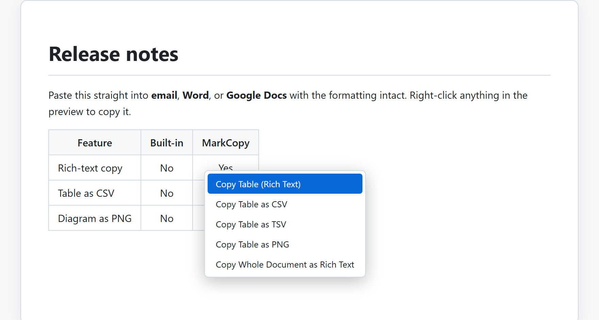
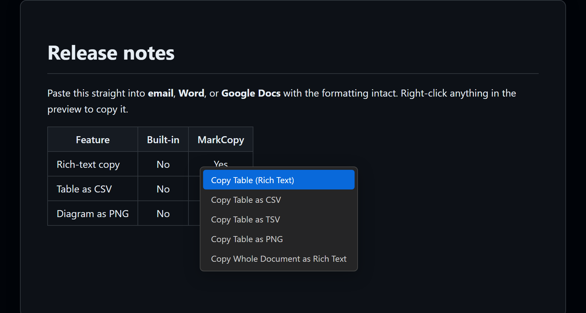

# MarkCopy

**Read any document in VS Code, touch it up, and hand it off in the format the next person needs.**

Repositories are full of files that are not code: notes and specs in Markdown, data in CSV and Excel, reports in Word, decks in PowerPoint, PDFs, screenshots, screen recordings, 3D models. VS Code shows most of them as raw text or not at all, and getting one to a colleague who lives in Word or Gmail means a detour through other apps.

MarkCopy closes that gap. It turns the editor into a document workspace with three jobs:

- **Read.** Every one of those files opens as the real thing: a rendered page, a spreadsheet grid, a slide deck, a PDF with selectable text, a playable video, a model you can orbit. Nothing else to install for most formats.
- **Edit lightly.** Click a Markdown block or a CSV cell in the preview and change it in place. Every change is an ordinary edit to the file, so Ctrl+Z undoes it.
- **Hand it off.** Right-click anything to copy it in the format the destination wants: rich text that keeps its formatting in Word, Outlook, Gmail and Google Docs, a table as CSV, a diagram or video frame as PNG. Or save the whole document as PDF, Word, or PowerPoint, with real headings, lists and alt text so the result stays accessible.

## Install

Search **MarkCopy** in the Extensions view, or run `code --install-extension OwenPKent.markcopy`. Cursor, VSCodium and Windsurf users can install it from [Open VSX](https://open-vsx.org/extension/OwenPKent/markcopy).

Then open a Markdown or CSV file: its tab shows the rendered preview, and **Show Source** in the title bar swaps back to the text. Right-click inside the preview to see what you can copy. More in [Getting started](docs/guide/getting-started.md).

## What it opens

| Format          | Files                                                            | Highlights                                                                                                                                                                           |
| --------------- | ---------------------------------------------------------------- | ------------------------------------------------------------------------------------------------------------------------------------------------------------------------------------ |
| Markdown        | `.md`, `.markdown`, `.mdx`, and friends                          | GitHub styling, Mermaid, KaTeX math, footnotes, edit blocks in place, export to PDF/Word/PPTX                                                                                        |
| CSV and TSV     | `.csv`, `.tsv`, `.tab`                                           | A real grid with frozen headers; edit cells, insert and delete rows and columns                                                                                                      |
| Excel           | `.xlsx`, `.xlsm`                                                 | Sheet tabs, formatted values, merged cells; copy a sheet as rich text, Markdown, CSV, or TSV                                                                                         |
| Word            | `.docx`, `.docm`                                                 | Structured, readable text with lists, tables, footnotes, comments, and charts as tables                                                                                              |
| PowerPoint      | `.pptx`, `.pptm`                                                 | The whole deck in one scrollable column, ready to copy or re-export                                                                                                                  |
| PDF             | `.pdf`                                                           | Selectable text, pinned comments, copy a page as PNG                                                                                                                                 |
| LaTeX           | `.tex`, `.ltx`, `.latex`                                         | Compiled with your installed TeX engine and shown in the PDF viewer                                                                                                                  |
| Images and GIFs | `.png`, `.jpg`, `.webp`, `.avif`, `.bmp`, `.ico`, `.svg`, `.gif` | Copy as PNG, Markdown, or HTML; step through a folder; pin notes to areas of a picture; play, pause and scrub a GIF on its control bar, and step through its frames                  |
| Video           | `.mov`, `.mp4`, `.mkv`, `.webm`, and more                        | Plays inline with its own controls (play, volume, a seek bar with the time and time left, full screen); timecoded video notes; copy the current frame as PNG for a bug report        |
| Audio           | `.mp3`, `.wav`, `.ogg`, `.opus`, `.flac`, `.m4a`, `.aac`         | Plays inline with a click-to-seek waveform, a details panel (codec, levels, tags), speed control and keyboard shortcuts; timestamped notes; step through the audio files in a folder |
| STL             | `.stl`                                                           | 3D viewer with orbit, wireframe, and dimensions                                                                                                                                      |

Previews of other people's files (Word, PowerPoint, Excel, PDF) are read-only by design and need no Office install.

## Why rich copy matters

Copy from an ordinary Markdown preview and the clipboard holds only plain text, so Word, Outlook, Gmail and Google Docs paste `# heading *asterisks*`. Those apps render formatting only when it arrives as HTML. MarkCopy writes both HTML and plain text, with styles inlined so the formatting survives even Gmail and Outlook, which strip style sheets. Headings, bold, lists, tables, links and code arrive intact.

## Light and dark

The preview follows your VS Code theme with GitHub-light and GitHub-dark palettes.

## Documentation

**Using MarkCopy:** the [user guide](docs/guide/README.md) covers each format, [copying](docs/guide/copy.md), [exporting](docs/guide/export.md), and [settings and commands](docs/guide/settings.md). The [copy matrix](docs/COPY-MATRIX.md) lists every right-click action and exactly what it puts on the clipboard.

**Developing MarkCopy:** start with [Contributing](.github/CONTRIBUTING.md), then [Architecture](docs/ARCHITECTURE.md) and [Testing](docs/TESTING.md). Security reports go through [SECURITY](.github/SECURITY.md). Release notes are in the [changelog](CHANGELOG.md).

## Roadmap

- PlantUML support.
- An "email-safe" export profile (table-based layout, fully inlined).

## License

[MIT](LICENSE)
