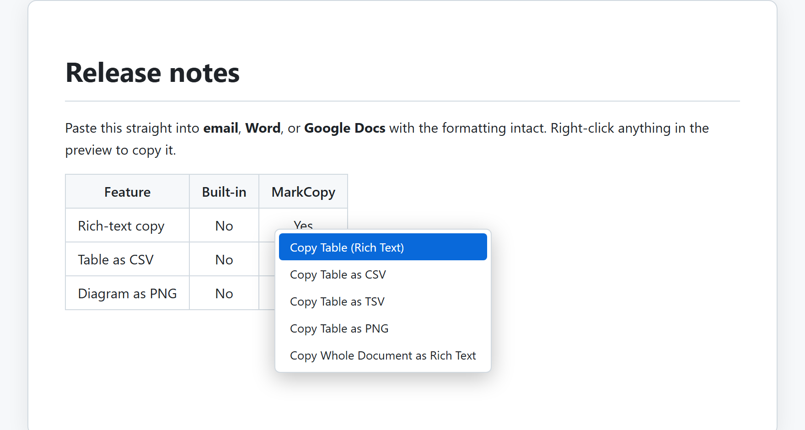
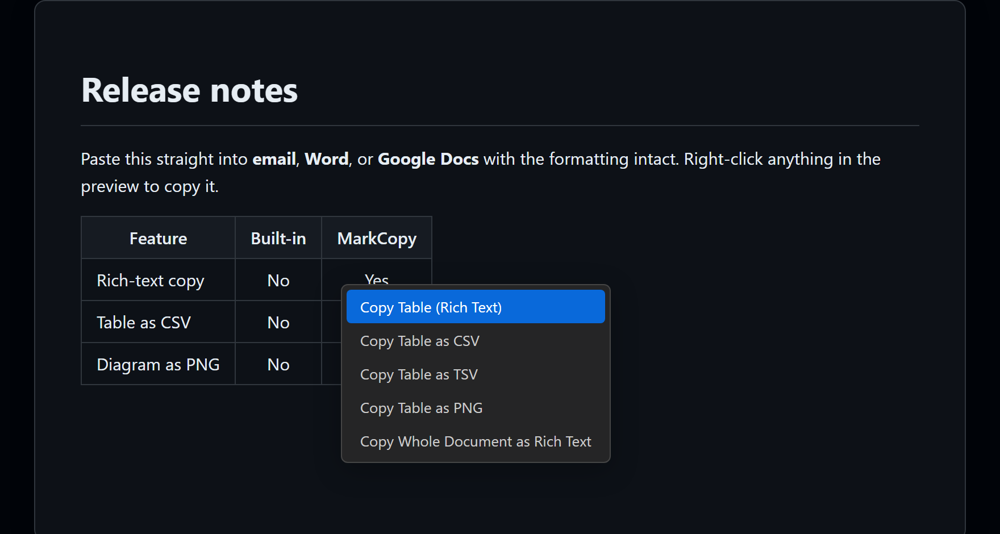
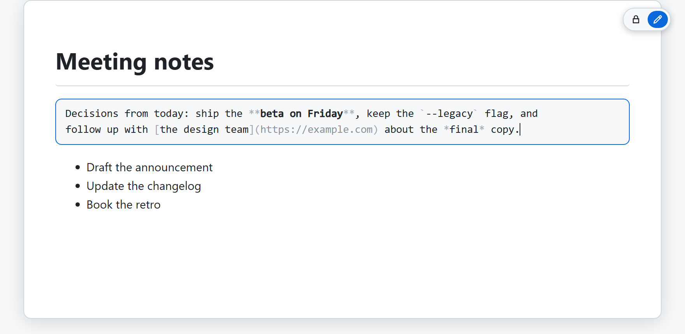
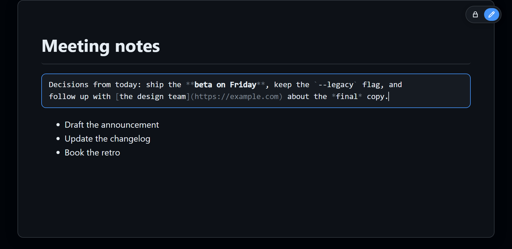
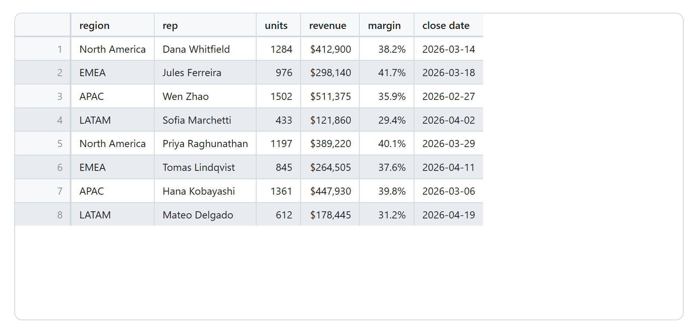
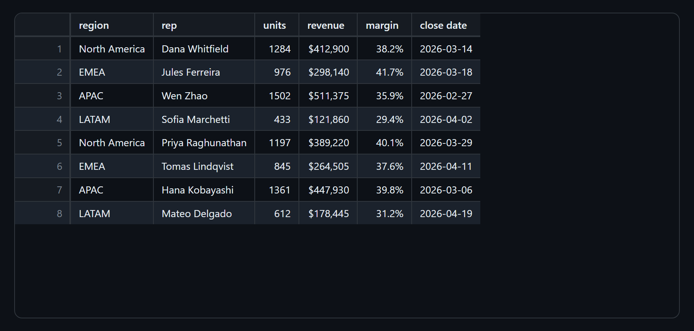
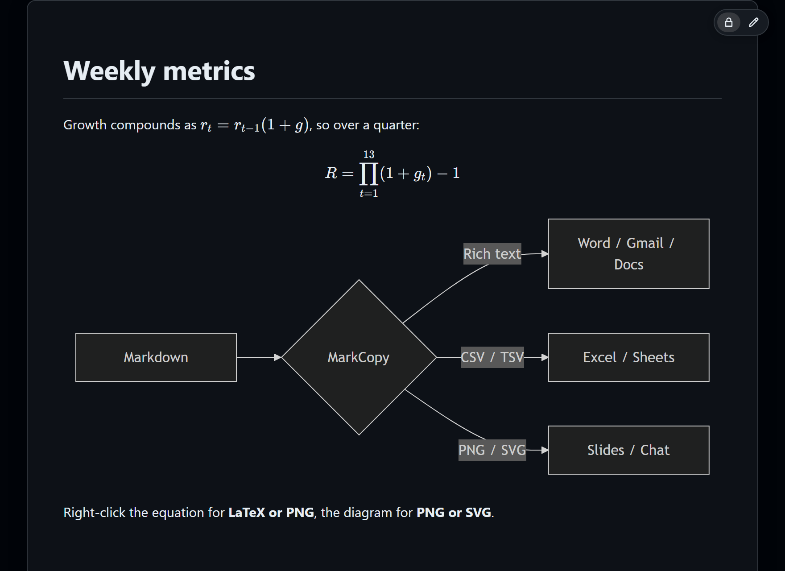
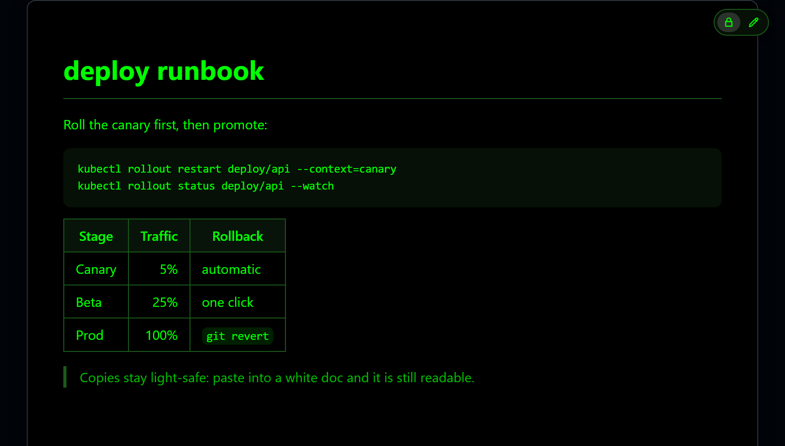
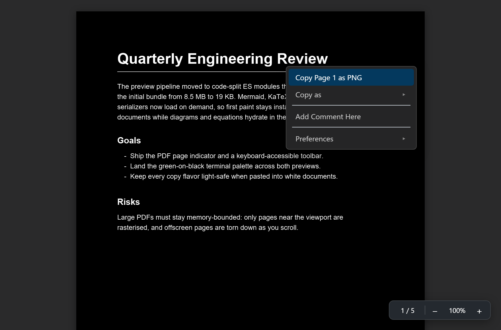
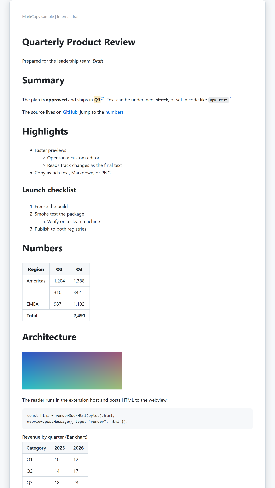

# MarkCopy: Rich Markdown, CSV, Excel, Word, PowerPoint, PDF, LaTeX, STL & Video Preview

[](https://marketplace.visualstudio.com/items?itemName=OwenPKent.markcopy)
[](https://open-vsx.org/extension/OwenPKent/markcopy)
[](https://github.com/owenpkent/markcopy/actions/workflows/ci.yml)
[](LICENSE)
[](https://code.visualstudio.com/)
[](.github/CONTRIBUTING.md)

**Install:** from the [VS Code Marketplace](https://marketplace.visualstudio.com/items?itemName=OwenPKent.markcopy), from [Open VSX](https://open-vsx.org/extension/OwenPKent/markcopy) (Cursor, VSCodium, Windsurf), or run `code --install-extension OwenPKent.markcopy`.

> The preview built for getting content _out_. Right-click anywhere in the rendered preview and copy it in the format you actually need: rich text that pastes **with formatting** into Word, Outlook, Gmail and Google Docs, a per-element copy of a code block or table, the raw Markdown source, or a PNG image of a diagram. Markdown blocks can be edited in place in the preview, and CSV cells too. It opens CSVs and Excel workbooks as a real spreadsheet-style grid, PDFs with a selectable text layer, LaTeX documents compiled and shown the same way, a Word document as readable, structured text, a PowerPoint deck as one scrollable column of slides, STL models in a 3D viewer, and `.mov` / `.mp4` / `.mkv` / `.webm` video in a player you can grab a frame from, so one extension previews them all.

VS Code's built-in preview and the popular alternatives (Markdown Preview Enhanced, Markdown All-in-One, GitHub Styling) have no first-class "copy the rendered output as rich text." MarkCopy is designed around exactly that.



<!-- The images are generated from the real preview bundles (media/webview.js, media/pdf.js) + media/preview.css via `npm run screenshot`. A screen-recorded GIF of pasting into Word or Gmail would be a welcome contribution. -->

MarkCopy follows your VS Code theme, with a polished GitHub-light or GitHub-dark palette:



Open a `.csv`, `.tsv`, or `.tab` and you get a proper grid: a header and row numbers that stay put as you scroll, alternating row colors, numbers aligned right, and columns you can drag to resize (double-click a divider to fit it to its contents). Cells are editable in place, whole rows and columns can be inserted or deleted, and every change goes straight into the file as an ordinary edit, so Ctrl+Z in the file's text editor undoes it normally.

Flip the lock/pencil pill in the top-right corner to edit Markdown right in the preview: click a block and its raw Markdown opens in a box with the syntax markers dimmed, and Ctrl/Cmd+Enter or clicking away writes it back to the file.









## Compared to the alternatives

|                                          | Built-in | Markdown Preview Enhanced | MarkCopy |
| ---------------------------------------- | :------: | :-----------------------: | :------: |
| Rich-text copy from the rendered preview |    No    |            No             | **Yes**  |
| Per-code-block copy                      |    No    |      Requested, open      | **Yes**  |
| Table as CSV / TSV / cells               |    No    |          Partial          | **Yes**  |
| Diagram as PNG to clipboard              |    No    |      Export to file       | **Yes**  |
| Copy block as Markdown source            |    No    |            No             | **Yes**  |
| Live preview + scroll sync               |   Yes    |            Yes            | **Yes**  |
| CSV / TSV grid preview                   |    No    |            No             | **Yes**  |
| Edit Markdown blocks in the preview      |    No    |            No             | **Yes**  |
| Edit CSV cells in the preview            |    No    |            No             | **Yes**  |
| Excel (.xlsx) preview                    |    No    |            No             | **Yes**  |
| Copy a spreadsheet range as Markdown     |    No    |            No             | **Yes**  |
| PDF preview built in                     |    No    |            No             | **Yes**  |
| LaTeX (.tex) preview                     |    No    |            No             | **Yes**  |
| STL 3D model preview                     |    No    |            No             | **Yes**  |
| QuickTime (.mov) video preview           |    No    |            No             | **Yes**  |
| Copy a video frame as PNG                |    No    |            No             | **Yes**  |
| Word (.docx) preview                     |    No    |            No             | **Yes**  |
| Export to Word (.docx)                   |    No    |        Via Pandoc         | **Yes**  |
| PowerPoint (.pptx) preview               |    No    |            No             | **Yes**  |
| Export to PowerPoint (.pptx)             |    No    |        Via Pandoc         | **Yes**  |

## Why it exists

When you copy Markdown you only get `text/plain`, the raw `# heading *asterisks*`. Word, Outlook, Gmail and Google Docs are rich-text editors: they render formatting only when it arrives on the clipboard as `text/html`. MarkCopy renders your Markdown, then writes **both** `text/html` and `text/plain` to the clipboard so the receiving app keeps your headings, bold, lists, tables, links and code. Styles are inlined so the formatting even survives Gmail and Outlook, which strip `<style>` blocks and external CSS.

## Features

- **Copy as Rich Text**, for the whole document or just a selection. Pastes formatted into Word, Outlook, Gmail, Google Docs, Slack and OneNote.
- **Edit mode.** Flip the lock/pencil pill in the top-right corner of a Markdown preview to edit the raw Markdown of a block in place: click a paragraph, heading, list, table, or quote, edit it in a box with light syntax dimming, and press Ctrl/Cmd+Enter or click away to write it back to the file (Escape cancels). It also works from the keyboard: Tab to a block, then Enter or F2 to edit it. It is an ordinary undoable editor change and the file is not saved for you.
- **Per-element right-click copy**, with a short top-level menu that names whatever you clicked and a **Copy as** submenu for every other format:
  - Link or email address: top level copies the target itself, as **Copy Link** or **Copy Email Address** (the address without its `mailto:` or any `?subject=`); **Copy as** has **Link Text** and a ready-made **Markdown** link. It leads the menu, ahead of a selection, since right-clicking a link names a single thing.
  - Selection: top level copies **Rich Text**; **Copy as** has **Markdown**.
  - Code block: top level copies **Plain Text**.
  - Table: top level copies **Rich Text**; **Copy as** has **Markdown**, **CSV**, **TSV** (both paste as real cells in Excel and Google Sheets), and **PNG**. This is also how a spreadsheet sheet leaves as a Markdown table.
  - Mermaid diagram: top level copies **PNG**; **Copy as** has **SVG**.
  - Equation (KaTeX): top level copies **PNG**; **Copy as** has **LaTeX**.
  - Any other block: top level copies **Rich Text**; **Copy as** has **Markdown source** and **PNG**.
- **Copy as raw Markdown**, for a selection or a single block, from the **Copy as** submenu.
- **Search Google for a selection.** Select some text and right-click for **Search Google for "…"**, which opens the search in your browser.
- **Save as PDF.** Export the rendered preview straight to a PDF file: pick where to save it and MarkCopy writes it, then opens it. No print dialog to work through and no filename header or URL footer on the pages, with equations, diagrams, highlighted code, and local images intact and the text still selectable. See [Save as PDF](#save-as-pdf).
- **Save as Word.** Export the rendered preview to a `.docx` file. Unlike the PDF, what lands is a real document rather than a picture of one: headings are Word headings, tables have a marked header row, lists are lists, and images retain their supplied alt text. This gives **Read Aloud**, Immersive Reader, and screen readers the structure they need, and supports Word's Accessibility Checker when the source includes meaningful alt text. It is also still editable. Mermaid diagrams and equations become images described by the source they came from, so a diagram is not simply silent. See [Save as Word](#save-as-word).
- **Save as PowerPoint.** Export the rendered preview to a `.pptx` file. Like Save as Word and unlike the PDF, what lands is a real, editable deck rather than a picture of one: headings become slide titles, lists are bulleted paragraphs at their real indent levels, tables are PowerPoint tables with a marked header row, images carry their alt text as the shape description, and links stay clickable. See [Save as PowerPoint](#save-as-powerpoint).
- **Excel preview.** Open an `.xlsx` or `.xlsm` and it renders as a grid, with sheet tabs along the top and the column letters and row numbers a spreadsheet shows. Values appear the way the workbook formats them, so a date is a date and not `45000`, a percentage is `15.3%` and not `0.153`, and a formula shows its stored result. Merged cells stay merged, and anything the author hid (rows, columns, or whole sheets) stays hidden. Then right-click and take the whole sheet out as rich text, Markdown, CSV, TSV, or PNG.

  The preview is **read-only by design**: MarkCopy never writes to your workbook, so it cannot corrupt one. See [Settings](#settings) for `markcopy.xlsx.*`.

- **Word preview.** Open a `.docx` or `.docm` and it renders as a readable document in reading order, so what you copy out is structured text rather than a picture of a page: headings (the Title style and Heading 1 to 6, or any paragraph with an outline level), bold, italic, underline, strikethrough, super- and subscript, monospace runs as code, bulleted and numbered lists with their nesting and start numbers, tables with merged cells and a marked header row, links (web and mail links only), images with their alt text, footnotes and endnotes, equations, the first header and last footer, text boxes, comments, and charts (as tables of their saved values). Tracked changes show the final text, and a field shows the result Word last computed. Page layout is not drawn. Everything copies the way it does in the other previews (**Copy as Rich Text**, **Copy as Markdown**, per-table CSV, **Save as PDF**, **Save as Word**), and the right-click **Search Google** row works on a selection.

  The preview is **read-only by design**: MarkCopy never writes to your document. See [Word preview](#word-preview).

- **PowerPoint preview.** Open a `.pptx` or `.pptm` and the whole deck renders as one scrollable column of slides, rather than one slide at a time behind a tab strip: a deck is read end to end, and rendering it that way is what lets **Copy as Rich Text**, **Save as PDF**, and **Save as Word** take the whole thing in one go instead of whichever slide happened to be on screen. Slides keep their real layout, but the markup underneath is semantic and in reading order, so a title placeholder becomes a heading, body text becomes paragraphs and lists, a slide table becomes a real table, and a picture keeps its alt text. Charts, SmartArt, OLE objects, and embedded media are drawn as labelled placeholders naming what they are, never as blanks; transitions and animations are not rendered. Speaker notes appear under each slide (`markcopy.pptx.showNotes`), and every slide is its own right-click block, so **Copy Rich Text / Markdown / PNG** work per slide, and a table on a slide gets the full table menu.

  The preview is **read-only by design**: MarkCopy never writes to your presentation. See [Settings](#settings) for `markcopy.pptx.*`.

- **CSV and TSV preview, with editing.** Open a `.csv`, `.tsv`, or `.tab` and it renders as a spreadsheet-style grid instead of a wall of commas: a sticky header row and row-number gutter, alternating row colors, numeric columns aligned right, and long values clipped with an ellipsis so rows stay one line tall. The delimiter is detected automatically (comma, tab, semicolon, or pipe, with a `.tsv` or `.tab` always read as tab-separated) and quoted fields follow RFC 4180, so commas, quotes, and newlines inside a cell all survive. See [Settings](#settings) for `markcopy.csv.*`.
  - **Edit cells in place.** Click to select, then double-click, press Enter or F2, or just start typing. **Enter** commits and moves down, **Tab** commits and moves right, **Shift+Enter** puts a newline inside the cell, **Escape** discards, **Delete** clears, and the arrow keys move around. Headers are editable too. Edits go straight into the file as ordinary document changes, and only the edited field is rewritten: the rest of the row keeps its original bytes, quoting and line endings included.
  - **Insert and delete rows and columns.** Right-click a cell, a column header, or a row number: **Insert** offers Row Above, Row Below, Column Left, and Column Right, and **Delete** offers Row and Column. A new row is blank and as wide as the row it lands next to, so a ragged file stays as ragged as it was; a new column opens down the whole file, not just the rows on screen. The grid then moves under the cursor the way a spreadsheet does, so after Insert Row Above you are standing on the new blank row. Like a cell edit, each one is written into the file as a single change, so one **Ctrl+Z** takes back a column that touched ten thousand rows, and every field that did not move keeps its original bytes.

  - **Undoing an edit.** Every change the grid makes is an ordinary edit to the document, so it lands in that file's normal undo stack: **Ctrl+Z** in the file's own text editor takes back the last cell, row, or column, one press per change, and the grid re-renders to follow. It has to be the text editor that has focus, though. Pressing Ctrl+Z with the preview focused does nothing, because VS Code sends undo to a focused editor and a preview panel is not one. For the same reason, keep the file open in an editor while you work in the grid: with no text editor for it anywhere, an edit has nothing to land in and is dropped.
  - **Resizable columns.** Drag any column divider, double-click one (or press Enter on it) to fit the column to its contents, and right-click for **Reset Column Widths**.
  - **Copy anything out.** The grid is a real table, so the whole right-click copy menu works on it: **Copy Table** as rich text, or **Copy as** CSV, TSV, or PNG. The row-number gutter is viewer chrome and stays out of every one of them, so what you paste is the data in the file. A single cell comes out too, under **Copy as** > **Cell Text**, and when a cell holds an email address or a URL, the menu leads with **Copy Email Address** / **Copy Link** and takes just that value out of whatever text surrounds it, which nothing else in a `.csv` can do without a careful drag.
- **Live preview** that updates as you type, with editor and preview scroll kept in sync.
- **Auto-open preview**, on by default (`markcopy.autoPreview`). Opening or focusing a Markdown, CSV, TSV, or TAB file shows the rendered document in that file's own tab: one tab, one editor group, nothing split off to the side. **Show Source** in the title bar gets you back to the text, and keeps you there for that file. A tab you have pinned, or one with unsaved changes, stays in the text editor untouched. LaTeX is the exception, and opens beside its source rather than over it. Turn the setting off and the preview is still a click away on the **Show Preview** button, or a **MarkCopy: Open Rich Preview to the Side** away if you want the two-column layout.
- **GitHub-accurate styling** for output that pastes cleanly into docs and email.
- **Footnotes.** `[^note]` references render as numbered links to their definitions, with return links back to the prose. A definition with no reference stays in place as plain text rather than disappearing. Toggle with `markcopy.footnotes` (on by default, turn it off for documents that use literal `[^...]` text).
- **First-class light and dark.** The preview matches your theme with a GitHub-light or GitHub-dark palette, and copied rich text is always light-safe, so it stays readable when pasted into a white document even from a dark preview. A **green-on-black** terminal palette is available too (`markcopy.theme: green`, or **Green on black** under **Preferences > Theme**).
- **Mermaid diagrams** (flowchart, sequence, class, state, gantt, pie, and more) that follow the light/dark theme, plus syntax-highlighted code, out of the box. Configure Mermaid via `markcopy.mermaid`; diagrams keep the classic layout and look unless you set `"layout": "elk"` or `"look": "neo"`.
- **Math rendering with KaTeX.** Inline `$...$` and display `$$...$$` Markdown math render as equations. Right-click one to copy it as a PNG or restore its original LaTeX source; "Copy as Markdown" also restores the LaTeX rather than the rendered markup. Toggle with `markcopy.math` (on by default, turn it off for docs that use literal dollar signs).
- **Local images render in the preview.** Relative and absolute paths (``, ``) resolve to the right file; remote (`http(s):`), `data:`, and `blob:` images are unchanged.
- **PDF preview built in.** Open any `.pdf` and MarkCopy renders it with pdf.js, with a real selectable text layer, right-click **Copy Page as PNG** or **Copy Selection**, and **Copy as** for page or document text. A floating toolbar shows the current page (click it to jump to any page), zooms from 50 to 400 percent while keeping pages crisp, and has a fit-width button that sizes the page to the pane and keeps it fitted as you resize; a **Preferences** submenu toggles between a Hand tool (drag to pan) and a Pointer tool (select text), and right-click **Add Comment Here** drops a pin comment saved next to the PDF. The pages share the Markdown preview's **Theme** submenu (Auto, Light, Dark, or **Green on black** phosphor), plus a session-only **Dark Pages** / **Light Pages** quick toggle, both under **Preferences**. One extension previews Markdown, CSV, Excel, Word, PowerPoint, PDF, LaTeX, STL, and video.
- **LaTeX preview.** Open or focus a `.tex`, `.ltx`, or `.latex` file and the preview opens automatically beside it, the same as Markdown, CSV, and TSV (`markcopy.autoPreview`); it is also reachable by hand from **Reopen Editor With...**. The file itself still opens in the text editor, since it is contributed at `option` priority, not default: it is a file you spend most of the day editing, and the preview simply arrives as a second tab beside it. MarkCopy compiles it with an external LaTeX engine and shows the result through the very same PDF viewer above, inheriting all of it: text selection, **Copy Page as PNG**, comments, zoom, and the **Theme** submenu. It rebuilds on save, and a floating **Recompile** button, a toolbar icon, and a right-click **Recompile LaTeX** entry rebuild it without one. Requires a LaTeX engine on your machine already; see [LaTeX preview](#latex-preview) for what to install.
- **STL 3D preview.** Open an `.stl` and it opens in a Three.js viewer instead of a wall of binary: left-drag to orbit, right-drag to pan, scroll to zoom, with the camera fitted to the model on load. A small toolbar offers **Fit view**, **wireframe**, and **grid**, and an overlay reports the triangle count and the bounding-box dimensions. Both binary and ASCII STL are read. There are no copy actions here: a triangle soup has nothing meaningful to put on a clipboard, so it is a viewer only. See [STL preview](#stl-preview).
- **Video preview with frame grabs.** Open a `.mov`, `.mp4`, `.m4v`, `.mkv`, `.webm`, `.avi`, `.wmv`, `.flv`, `.mpg`, `.mpeg`, or `.3gp` and it plays inline with full transport controls, rather than opening as binary or not at all: VS Code ships no preview for QuickTime files. Right-click for **Copy Frame as PNG** and **Save Frame as PNG…**, so a still from a screen recording goes straight into a bug report. A **Playback** submenu sets looping, speed, and autoplay, and `,` and `.` step a frame at a time to line the shot up. A file VS Code cannot decode (ProRes, DNxHD, most HEVC) plays anyway when you have ffmpeg: MarkCopy builds a throwaway H.264 copy in a temp folder, laying a clip with an alpha channel over a transparency checkerboard rather than flattening it onto black. Without ffmpeg it says what is wrong and offers your default player. See [Video preview](#video-preview).
- **Settings without leaving the preview.** Right-click for the **Preferences** submenu (**Theme**, and **Sync scroll** / **Auto-open preview** / **Math** / **Footnotes** toggles), or use the gear icon in the preview's title bar. Both write straight to your VS Code settings.



The optional green-on-black terminal palette (`markcopy.theme: green`):



See the full breakdown in the [Copy Matrix](docs/COPY-MATRIX.md): every action, the clipboard flavor it writes, and where it pastes cleanly.

## Getting started

1. Install the extension (see [Install](#install)).
2. Open any `.md`, `.csv`, `.tsv`, or `.tab` file. Its tab shows the rendered preview (`markcopy.autoPreview`), and **Show Source** in the title bar swaps back to the text. For the two-column layout instead, run **MarkCopy: Open Rich Preview to the Side** from the Command Palette or the right-click menu in the editor or Explorer. (`.pdf`, `.stl`, and video files open straight in their own viewers. A `.tex` file is different again: it is a file you also edit, and its preview is a compiled PDF, so the source stays in the text editor and the preview opens beside it rather than over it. See [LaTeX preview](#latex-preview).)
3. **Right-click inside the preview.** The menu options change based on whether you clicked a code block, table, diagram, plain block, or a text selection.

To grab everything at once, run **MarkCopy: Copy Whole Document as Rich Text**, or **MarkCopy: Save as PDF** to export the whole preview to a PDF file.

Local images in the document render automatically, and the right-click menu's **Preferences** submenu (or the gear icon in the preview's title bar) lets you change theme, sync scroll, math, and auto-preview without leaving the preview.

**The tab swaps between the two views; it never splits.** Two buttons share the leftmost slot in the editor title bar: **Show Preview** (`$(open-preview)`) turns a `.md`, `.csv` or `.tsv` tab into the rendered document, and **Show Source** (`$(go-to-file)`) turns it back. Only one of them shows at a time, so it reads as one toggle. Neither opens a second editor group, and neither leaves you with two tabs on one file. A tab you have pinned, or a source with unsaved changes, is left open rather than closed.

With `markcopy.autoPreview` on (the default), opening one of those files does the **Show Preview** half for you, so you land on the rendered document without asking. **Show Source** takes you to the text and keeps you there for that file: MarkCopy will not swap it back on the next focus change.

It is the same preview either way, with the same right-click menu, the same **Save as PDF** and settings buttons, and the same editable CSV grid, and it keeps re-rendering as you edit the file in any other editor.

**For the old two-column layout**, run **MarkCopy: Open Rich Preview to the Side**: that command still opens the preview beside the source and retargets it as you move between files.

MarkCopy does not change what VS Code's _file association_ opens; the swap above is the extension acting after the fact, and turning `markcopy.autoPreview` off stops it. To change the association itself, **Reopen Editor With...** > **Set Default for '\*.md'** in the editor title menu does it per glob, or `settings.json`:

```json
{
  "workbench.editorAssociations": { "*.md": "markcopy.markdownPreview" }
}
```

## Commands

| Command                                    | ID                                | What it does                                                              |
| ------------------------------------------ | --------------------------------- | ------------------------------------------------------------------------- |
| MarkCopy: Open Rich Preview to the Side    | `markcopy.openPreview`            | Opens (or focuses) the preview beside the editor.                         |
| MarkCopy: Show Preview                     | `markcopy.openRendered`           | Swaps a Markdown, CSV, or TSV tab to the rendered preview, in place.      |
| MarkCopy: Show Source                      | `markcopy.openSource`             | Swaps a preview tab back to the text, in place.                           |
| MarkCopy: Copy Whole Document as Rich Text | `markcopy.copyDocumentAsRichText` | Copies the entire rendered document as rich text.                         |
| MarkCopy: Save as PDF                      | `markcopy.saveAsPdf`              | Exports the rendered preview to a PDF file you choose, then opens it.     |
| MarkCopy: Save as Word Document            | `markcopy.saveAsDocx`             | Exports the rendered preview to a `.docx` file you choose, then opens it. |
| MarkCopy: Save as PowerPoint               | `markcopy.saveAsPptx`             | Exports the rendered preview to a `.pptx` file you choose, then opens it. |
| MarkCopy: Recompile LaTeX                  | `markcopy.recompileTex`           | Recompiles the focused LaTeX preview.                                     |
| MarkCopy: Settings                         | `markcopy.openSettings`           | Opens the MarkCopy settings.                                              |

## Settings

`markcopy.syncScroll`, `markcopy.autoPreview`, `markcopy.math`, `markcopy.footnotes`, and `markcopy.theme` can also be changed live from the preview's right-click **Preferences** submenu or the gear icon in its title bar, not just here.

| Setting                        | Type                                                                       | Default   | Description                                                                                                                                                                                                                                                               |
| ------------------------------ | -------------------------------------------------------------------------- | --------- | ------------------------------------------------------------------------------------------------------------------------------------------------------------------------------------------------------------------------------------------------------------------------- |
| `markcopy.styleProfile`        | `github`                                                                   | `github`  | Rendering style. `github` matches GitHub Markdown (best for pasting into docs and email).                                                                                                                                                                                 |
| `markcopy.syncScroll`          | boolean                                                                    | `true`    | Keep the preview scroll position in sync with the editor.                                                                                                                                                                                                                 |
| `markcopy.autoPreview`         | boolean                                                                    | `true`    | Show the preview automatically when you focus a Markdown, CSV, or TSV file, in that file's own tab rather than a split beside it. Pinned and unsaved tabs are left alone; LaTeX previews beside its source. Turn off to open previews by hand.                            |
| `markcopy.theme`               | `auto` \| `light` \| `dark` \| `green`                                     | `auto`    | Preview palette. `auto` follows your VS Code theme; `light`, `dark`, and `green` (green-on-black terminal style) force it. Copies stay light-safe either way.                                                                                                             |
| `markcopy.mermaid`             | object                                                                     | `{}`      | Extra Mermaid config merged into `mermaid.initialize` (for example `fontFamily`, `flowchart`, or `themeVariables`). Diagrams follow the light/dark palette by default.                                                                                                    |
| `markcopy.math`                | boolean                                                                    | `true`    | Render `$...$` and `$$...$$` Markdown math as KaTeX equations. Turn off for documents that use literal dollar signs.                                                                                                                                                      |
| `markcopy.footnotes`           | boolean                                                                    | `true`    | Render `[^note]` footnote references and `[^note]: text` definitions as a numbered footnotes section. Turn off for documents that use literal `[^...]` text.                                                                                                              |
| `markcopy.csv.delimiter`       | `auto` \| `,` \| `\t` \| `;` \| `\|`                                       | `auto`    | Field separator for the CSV/TSV grid. `auto` picks whichever separator splits the file into the most consistent columns, except that a `.tsv` or `.tab` file is always read as tab-separated.                                                                             |
| `markcopy.csv.headerRow`       | boolean                                                                    | `true`    | Treat the first row of a CSV/TSV file as column headers. Turn off for files that start straight into data.                                                                                                                                                                |
| `markcopy.csv.maxRows`         | number                                                                     | `5000`    | Maximum rows to render. The grid says how many rows it is hiding; raise it to show more, at the cost of a slower preview on very large files.                                                                                                                             |
| `markcopy.csv.maxColumns`      | number                                                                     | `200`     | Maximum columns to render. The grid says how many columns it is hiding. It also draws at most 500,000 cells in total, so a very wide file shows fewer rows at a time.                                                                                                     |
| `markcopy.xlsx.maxRows`        | number                                                                     | `5000`    | Maximum rows to render from a spreadsheet sheet. The grid says how many rows it is hiding.                                                                                                                                                                                |
| `markcopy.xlsx.maxColumns`     | number                                                                     | `200`     | Maximum columns to render from a spreadsheet sheet.                                                                                                                                                                                                                       |
| `markcopy.pptx.maxSlides`      | number                                                                     | `100`     | Maximum number of slides to render from a presentation. The preview says how many it is hiding; raise this to show more, at the cost of a slower preview on very long decks.                                                                                              |
| `markcopy.pptx.showNotes`      | boolean                                                                    | `true`    | Show each slide's speaker notes under it in the preview. They are part of what a deck has to say, and they come along when you copy the slide.                                                                                                                            |
| `markcopy.pptx.slideSize`      | `16:9` \| `4:3`                                                            | `16:9`    | Slide size for **Save as PowerPoint**. `16:9` is widescreen (13.3 x 7.5in), `4:3` the older standard (10 x 7.5in). This does not affect previewing an existing deck, which is always shown at the size the file declares.                                                 |
| `markcopy.pdf.pageSize`        | `Letter` \| `A4` \| `Legal`                                                | `Letter`  | Paper size for **Save as PDF**.                                                                                                                                                                                                                                           |
| `markcopy.pdf.browserPath`     | string                                                                     | `""`      | Path to the Chrome, Edge, or Chromium executable used to render the PDF. Empty detects one automatically.                                                                                                                                                                 |
| `markcopy.tex.compile`         | `auto` \| `ask` \| `off`                                                   | `auto`    | When a LaTeX preview opens. `auto` compiles right away and again on every save; `ask` offers a button instead of starting on its own (good for a thesis-scale document); `off` never compiles.                                                                            |
| `markcopy.tex.engine`          | `auto` \| `latexmk` \| `tectonic` \| `pdflatex` \| `xelatex` \| `lualatex` | `auto`    | Which LaTeX engine to compile with. `auto` prefers `latexmk`, then `tectonic`, then `pdflatex`, since the first two rerun the document until cross-references and the bibliography settle. Choose `xelatex` or `lualatex` for documents using `fontspec` or system fonts. |
| `markcopy.tex.enginePath`      | string                                                                     | `""`      | Path to the LaTeX executable. Empty detects one automatically (PATH, then the usual MiKTeX, TeX Live, MacTeX, and TinyTeX install locations).                                                                                                                             |
| `markcopy.tex.rootFile`        | string                                                                     | `""`      | The document to actually compile, for a project where the file you have open is a chapter rather than the whole thing. Empty uses a `% !TEX root = ...` comment at the top of the file, and failing that the file itself.                                                 |
| `markcopy.tex.recompileOnSave` | boolean                                                                    | `true`    | Rebuild the LaTeX preview when you save the document, or a `.bib`, `.sty`, `.cls`, or `.tikz` file beside it. Turn off to rebuild only from the Recompile button.                                                                                                         |
| `markcopy.stl.showGrid`        | boolean                                                                    | `true`    | Show a grid under the model in the STL preview.                                                                                                                                                                                                                           |
| `markcopy.stl.meshColor`       | string                                                                     | `#8ab4f8` | Color of the mesh material in the STL preview.                                                                                                                                                                                                                            |
| `markcopy.video.autoplay`      | boolean                                                                    | `false`   | Start playing as soon as a video preview opens. Tries to play with sound; if VS Code requires a click first, it starts muted and the first click or key press in the preview turns the sound on. Also toggled from the right-click Playback menu.                         |
| `markcopy.video.loop`          | boolean                                                                    | `false`   | Repeat a video when it reaches the end. Also toggled from the preview's right-click **Playback** menu.                                                                                                                                                                    |
| `markcopy.video.review`        | boolean                                                                    | `false`   | Open videos in review mode, with a notes panel and timecoded markers, even without a `.review.yaml` file beside them. A video that has one opens in review mode regardless. Also toggled from the right-click **Review Notes** entry.                                     |
| `markcopy.video.transcode`     | `auto` \| `ask` \| `off`                                                   | `auto`    | What to do with a video VS Code cannot decode, or whose audio it cannot (AAC). `auto` builds a throwaway copy with ffmpeg (H.264 picture, MP3 sound); `ask` offers a button first; `off` only points at your default player.                                              |
| `markcopy.video.ffmpegPath`    | string                                                                     | `""`      | Path to the `ffmpeg` used to build that copy. Empty detects one automatically; `ffprobe` is taken from the same folder.                                                                                                                                                   |

## Install

**From the Marketplace** (published as [`OwenPKent.markcopy`](https://marketplace.visualstudio.com/items?itemName=OwenPKent.markcopy)):

- In VS Code: open the Extensions view, search **MarkCopy**, and click Install.
- Or from a terminal: `code --install-extension OwenPKent.markcopy`

It is also available on [Open VSX](https://open-vsx.org/extension/OwenPKent/markcopy) for Cursor, VSCodium, and Windsurf.

**From the packaged VSIX** (local build):

```bash
npm ci
npm run vsix                                   # produces markcopy-<version>.vsix
code --install-extension markcopy-<version>.vsix
```

See [RELEASING.md](docs/RELEASING.md) for how releases are cut and published.

## How the copy works

`vscode.env.clipboard` is text-only, so rich copy happens **inside the webview**. MarkCopy writes both `text/html` and `text/plain` through a synchronous `copy`-event handler, which is more reliable than the async Clipboard API (that one can be permission-blocked inside the webview iframe). PNG copy uses `html-to-image` plus a `ClipboardItem`. The full rationale, including the Gmail/Outlook inline-styling requirement, is in [docs/ARCHITECTURE.md](docs/ARCHITECTURE.md#clipboard).

## Save as PDF

**MarkCopy: Save as PDF** (or the PDF button in the preview's title bar, or **Save as PDF…** in the right-click menu) asks where to save, writes the file, and opens it. What comes out is the preview as you see it: equations, diagrams, highlighted code, and local images intact, and real text rather than a picture of text, so it stays selectable and searchable.

It renders with a headless Chrome, Edge, or Chromium already installed on your machine instead of handing you to a browser's print dialog, which is what keeps the output clean:

- **No header or footer.** A print dialog stamps the document title across the top of every page and the `file://` URL across the bottom by default. Nothing does that here.
- **No stray page breaks.** A code block or table longer than a page flows across pages instead of being pushed onto one of its own, a table's header row repeats on every page it spans, and long code lines wrap instead of being cut off at the margin.
- **Backgrounds survive.** Code blocks, table headers, and blockquotes keep their fill, which a browser print drops unless you remember to ask for it.

`markcopy.pdf.pageSize` sets the paper size (Letter, A4, or Legal). If your browser is installed somewhere unusual, point `markcopy.pdf.browserPath` at it. With no Chromium-family browser installed at all, MarkCopy falls back to opening the preview in your default browser for you to print by hand.

## Save as Word

**MarkCopy: Save as Word Document** (or **Save as Word…** in the preview's right-click menu) asks where to save, writes a `.docx`, and opens it.

This is the export to reach for when the document has to be **read aloud**, or edited after it lands. A PDF keeps the layout and the images and nothing else: it is a picture of a page, and a screen reader has to infer the reading order from where the ink fell. A `.docx` keeps the structure, and structure is what assistive software actually reads:

- **Headings are Word headings.** `#` through `######` become the built-in Heading 1-6 styles, which carry an outline level. That is what fills the Navigation Pane and what lets a screen reader jump from section to section instead of arrowing through the prose.
- **Tables declare their header row.** The header row is marked as one, so a reader hears "Revenue, 4.2m" rather than "4.2m", and Word repeats it across page breaks.
- **Images carry their alt text.** `` arrives with that sentence attached, which is what Read Aloud speaks and what the Accessibility Checker looks for.
- **Lists are lists**, numbered by Word rather than by a bullet character typed into the text, so each one is announced with its position and count. Separate numbered lists restart at 1, and `4.` starts at four.
- **Links keep their targets**, and a link to a heading in the same document lands on that heading.

Mermaid diagrams and equations have no Word equivalent, so they are rasterized. Their **alt text is the source they came from**: a flowchart reads aloud as its Mermaid source and an equation as its LaTeX, which is a good deal better than silence. Code blocks keep their syntax colors and become one paragraph per line, so a reader can step through them a line at a time.

**Alt text is the one thing MarkCopy cannot supply for you.** `` with an empty alt is the norm in Markdown, and it is exactly what makes a document stop being audible. So the export counts them and tells you: _"exported report.docx, but 3 images without alt text (a screen reader will skip past them)."_ Fix them in the Markdown and export again.

Everything is written in memory and needs nothing installed: no Word, no Pandoc, no browser. The same export works from the CSV, TSV, Excel, and PowerPoint previews, where a sheet becomes a Word table with its header row marked and a deck becomes one section per slide.

## Save as PowerPoint

**MarkCopy: Save as PowerPoint** (or **Save as PowerPoint…** in the preview's right-click menu) asks where to save, writes a `.pptx`, and opens it.

Like [Save as Word](#save-as-word) and unlike Save as PDF, what lands is a real, editable deck rather than a picture of one:

- **Headings become slide titles, and slides split where they should.** A thematic break (`---`) or an `<h1>` / `<h2>` starts a new slide, and a heading right after either becomes that slide's title. Content before the first boundary is its own slide, a title slide when it is only a heading. A deck written for a tool like Marp splits the same way, since its headings already sit one to a section.
- **Lists are bulleted paragraphs at their real indent levels**, not a picture of bullets.
- **Tables become PowerPoint tables**, with a marked header row.
- **Images carry their alt text**, as the shape's own description.
- **Links stay clickable.**

Mermaid diagrams and equations have no PowerPoint equivalent any more than they have a Word one, so they are rasterized the same way. **Overflow is not repaginated**: a slide whose content runs past the bottom edge is left overflowing rather than silently split into two, since splitting one would scramble a deliberate build. The export counts what is worth knowing (images with no alt text, images it could not embed, slides that likely ran over) and reports it after saving, the same way Save as Word reports missing alt text.

Everything is written in memory and needs nothing installed: no PowerPoint, no Pandoc, no browser. The same export works from the Markdown, CSV, TSV, and Excel previews too, not just the PowerPoint preview. `markcopy.pptx.slideSize` sets the slide size (`16:9` default, or `4:3`); it has no effect on previewing an existing deck, which always shows at the size the file declares.

## PDF preview

MarkCopy registers as the editor for `.pdf` files, so opening a PDF renders it inline (VS Code has no built-in PDF viewer). Rendering uses Mozilla's pdf.js, the same engine behind [folio](https://github.com/owenpkent/folio). Each page has a real, selectable text layer over the canvas, so you can highlight text directly on the page. Right-click a page for:

- **Copy Selection**: just the text you highlight (only shown when you have a selection).
- **Copy Page as PNG**: the rendered page as an image, for slides and chat.
- **Copy as**: **Page Text** or **All Text**, the selectable text extracted per page or for the whole document.
- **Add Comment Here**: drop a pin with an editable note; click a pin to edit or delete it. Comments are saved to a `<filename>.pdf.mccomments.json` file next to the PDF (the PDF itself stays read-only) and reload when you reopen it.
- **Preferences**: toggle between **Hand Tool (Drag to Scroll)** and **Pointer Tool (Select Text)**, toggle **Dark Pages** / **Light Pages** (a session-only override of the page palette that does not change the saved theme), and open the same **Theme** submenu as the Markdown preview (Auto, Light, Dark, or Green on black). Picking a theme persists `markcopy.theme` (shared with the Markdown preview) and re-tints the pages; Green on black renders them as green-on-black phosphor.



A floating toolbar in the bottom-right corner shows the current page (for example `3 / 12`) as you scroll; click it, type a page number, and press Enter to jump there. The same toolbar steps zoom through preset levels (50 to 400 percent) with minus/plus buttons, Ctrl and plus / Ctrl and minus / Ctrl and 0, or Ctrl plus the mouse wheel; clicking the percentage resets to 100 percent. The fit-width button (a page with a double-headed arrow across it, the same icon [folio](https://github.com/owenpkent/folio) uses) fits the page to the width of the pane and stays on, re-fitting as you resize the editor, until you zoom by hand again. Zooming keeps your place: whatever sits in the middle of the view stays there instead of the page sliding out from under you. Pages re-rasterise at each level, and only pages near the viewport stay rendered, so large PDFs stay sharp and memory-bounded. The view also has always-visible styled scrollbars.

The file is read by the extension host and handed to the webview as bytes, so nothing is fetched over the network. To open a PDF as raw bytes instead, use **Reopen Editor With...** from the editor title menu.

## STL preview

MarkCopy registers as the editor for `.stl` files, so opening one renders the model inline in a Three.js viewer. Controls are mouse-only, no keyboard required: **left-drag** to orbit, **right-drag** to pan, **scroll wheel** to zoom. The camera fits itself to the model on load, and the toolbar in the top-left offers **Fit view**, a **wireframe** toggle, and a **grid** toggle. An overlay in the bottom-left reports the triangle count and the bounding box as X x Y x Z.

Both binary and ASCII STL are handled. The model is centered in X and Z and rested on the y = 0 plane, so the grid always sits directly under it. The viewport background follows `markcopy.theme` along with the other previews; `markcopy.stl.showGrid` and `markcopy.stl.meshColor` set the grid and mesh color.

Corrupt and hostile files are rejected rather than loaded: a binary STL whose header claims more triangles than the file can hold, any model above ~5.4 million triangles, or any file above 256 MiB shows a message in the panel instead of hanging the viewer on a multi-gigabyte allocation. The size is checked before the file is read, not after. As with the PDF viewer, the file is read by the extension host and handed to the webview as bytes, so nothing is fetched over the network, and **Reopen Editor With...** opens the raw bytes instead.

There are no copy actions in this viewer, by design: an STL is a triangle soup with no text, tables, or images to put on a clipboard.

## Video preview

MarkCopy registers as the editor for `.mov`, `.mp4`, `.m4v`, `.3gp`, `.mkv`, `.webm`, `.avi`, `.wmv`, `.flv`, `.mpg`, and `.mpeg`, so a video opens as a player instead of as binary. (`.ts`, `.mts`, and `.m2ts` are left alone: `.ts` is TypeScript.) VS Code's own player opens only the MP4 family, and nothing at all opens a QuickTime `.mov`, which is what a Mac screen recording, a phone clip, and most camera footage arrive as. Measured in VS Code's webview, `.webm` does not open either, despite VS Code's documentation: every container outside `.mp4`, `.mov`, `.m4v`, and `.3gp` is refused at once, even when it holds H.264 or VP9 that plays fine inside an MP4.

The player has the standard transport controls plus a few shortcuts: **space** plays and pauses wherever the focus is, **`,`** and **`.`** step back and forward roughly a frame, **m** mutes, **f** goes fullscreen. A readout under the video gives the file name, pixel dimensions, duration, and size.

Right-click for the copy actions:

- **Copy Frame as PNG** puts the frame currently on screen on the clipboard at the video's true resolution, not the on-screen size.
- **Save Frame as PNG…** writes it to disk, defaulting to the video's own folder with the timecode in the name (`clip-1m23.400s.png`), so successive grabs never overwrite each other.
- **Copy as** gives the file name or full path.
- **Playback** sets looping (persisted to `markcopy.video.loop`) and speed from 0.25x to 2x.
- **Review Notes** turns review mode on or off, and **Copy Notes as Markdown** sits beside it (see below).
- **Preferences → Theme** shares the setting with every other MarkCopy preview.

**Review mode.** A video with a `<stem>.review.yaml` file beside it (`clip.review.yaml` for `clip.mp4`), the notes file written by [Marker](https://github.com/owenpkent/Marker) and the okstudio-video-kit, opens in review mode; so does every video when `markcopy.video.review` is on, or after ticking **Review Notes** in the right-click menu. The native controls give way to a transport (play, step a frame back or forward at the video's real frame rate, speed 0.5x, 1x or 2x, and a timecode readout that says which frame rate it is using and where it came from), a scrubber with a marker for each note (close ones cluster, and a range note gets a bar), and a notes panel beside the video, or below it in a narrow editor, with one card per note. Pressing a marker or a card jumps to that note. **Left** and **Right** step a frame; **J**, **K** and **L** slow, pause and speed up. The frame rate comes from the notes file, else from ffprobe's average rate (needs ffmpeg), else 30, marked as assumed. MarkCopy reloads the panel when another tool changes the file. A notes file MarkCopy cannot validate still shows its notes, under a read-only banner, and is never written.

**Writing notes.** The foot of the panel is a composer: **[ In** and **Out ]** set the start and end from the playhead (or press **I** and **O**), a chip shows the pending range with **Clear**, a play/pause button, a **Note text** field and **Send**. With no range set, the note is a point at the playhead. **Enter** sends and **Escape** leaves the field. Clicking into the field pauses the video, and sending resumes it if it was playing. The selected card has **Done** / **Not done** and **Delete**; after a delete, **Restore nN** at the top of the panel brings the note back under its old id (one level, this panel only). The first note on a video with no notes file creates `<stem>.review.yaml`, at the video's frame rate, or at 30 fps with a line above the composer saying so when the rate is unknown. Every change is written to the notes file in the same layout the okstudio-video-kit uses, so Marker opens it, and `<stem>.review.md` is rewritten after each one. If Marker saves over a note MarkCopy wrote, the panel says "Notes were replaced by another program".

**Filter, bands and pins.** Two buttons at the top of the panel cycle the filter (**All**, **Pending**, **Done**) and the sort (**Time**, **Newest**, by when the note was created). A caption such as "Showing Pending, newest first" appears when either is changed, the count reads "2 of 4 notes", and an empty result says "No notes match this filter." The choice is remembered for that panel, not in settings, and the scrubber still shows every note. A range note draws a translucent band over the scrubber with bracket end caps, brighter when selected; the pending range is drawn the same way, as just the In bracket until Out is set. To pin a note to a spot, press the picture: a ring with a plus marks the spot, the video pauses and the note field takes focus. Press again to move it; a press in the letterbox does nothing, and **Clear** drops the range and the pin. The chip reads "Pin" or "00:00:01:00 + Pin". Send stores the spot as `point` (0 to 1 across and down the picture), and resumes playback only if it was running before the first press. A pinned note shows a numbered stud on the picture while the playhead is on its frame or inside its range; pressing it goes to the note, and its card says "Pin". Outside review mode, or when the panel is read-only, a press on the picture still plays and pauses.

**Copy Notes as Markdown** (in the menu and on the panel) builds the same Markdown Marker writes, saves it as `<stem>.review.md` beside the video, and puts it on the clipboard, so you can paste it into a chat or leave it for an agent working in the folder. The video preview writes the notes file and this Markdown file without asking where, and never touches the video. Marker does not re-read its notes before saving, so do not edit one video in both at once.

Unlike the PDF and STL viewers, the file is streamed rather than read: the webview is handed a resource URI and the player pulls ranges off disk as it plays, so a multi-gigabyte clip opens as fast as a small one and costs no more memory. Nothing is fetched over the network.

**On codecs.** QuickTime is a container, not a codec. VS Code's Chromium decodes H.264 video, which covers screen recordings, phone footage, and most `.mov` files you are handed, but it has no AAC decoder: an ordinary H.264/AAC file plays its picture in silence, with no error to say why. It also cannot decode ProRes, DNxHD, or (on most builds) HEVC, which is what a `.mov` straight out of a professional camera or editor usually holds.

**Silent video gets a sound copy, if you have ffmpeg.** When a file plays but its audio is something VS Code cannot decode, MarkCopy builds a copy with MP3 sound (the picture stream is copied untouched, so it takes seconds) and swaps it in at the same position, still playing. A slim notice above the status line shows the progress without hiding the video; under `ask` the notice offers a **Build Copy with Sound** button instead, and **Dismiss** hides it. Without ffmpeg nothing is shown. The status line says `ffmpeg copy · sound re-encoded to MP3` while the copy is on screen.

**A video in the wrong container is repackaged in seconds.** A `.mkv` or `.webm` holding H.264, VP9, or AV1 fails only because of its wrapper, so with ffmpeg MarkCopy copies the picture into an MP4 without re-encoding it (the audio becomes MP3). The offer says so ("VS Code's player cannot open .mkv files. MarkCopy can repackage clip.mkv as MP4 with ffmpeg in a few seconds") and the status line reads `ffmpeg copy · repackaged as MP4`. WMV, MPEG-2, VP8, and the like take the full re-encode below; without ffmpeg the message names the container and offers your default player.

**Those play anyway, if you have ffmpeg.** When a file turns out to be undecodable, MarkCopy looks for `ffmpeg` (on `PATH`, then the usual install locations, or wherever `markcopy.video.ffmpegPath` points) and encodes a throwaway H.264 copy to a temp folder, with a progress bar and a **Cancel** button while it runs. The copy is what plays; your original is never touched, and the copy is deleted when you close the tab. The status line says `ffmpeg preview copy` for as long as one is on screen.

A clip with an **alpha channel** (a ProRes 4444 lower third, say) is laid over a transparency checkerboard rather than flattened onto black, because a 99%-transparent graphic composited onto black looks exactly like a clip that renders nothing. The status line says `alpha on checkerboard` in that case, which also tells you the board is baked into any frame you grab.

Set `markcopy.video.transcode` to `ask` if you work with long 4K masters and would rather press a button than have an encode start on its own, or to `off` to keep the old behaviour: a message naming the likely cause and an **Open in Default App** button. With no ffmpeg installed you get that same message, plus a note that installing one would let MarkCopy play the file here.

## LaTeX preview

MarkCopy registers an editor for `.tex`, `.ltx`, and `.latex` files, but as an option rather than the default: unlike a PDF, an STL, or a video, a `.tex` file is one you spend most of the day editing, so opening one still opens the text editor. The preview, though, opens on its own: with `markcopy.autoPreview` on (the default), opening or focusing a `.tex` file also opens (or reveals) the preview in a tab beside it, the same as Markdown, CSV, and TSV, without moving your cursor away from the source. Close that preview and it stays closed for that file until you reopen it. You can also reach it by hand: right-click the file (in the editor tab bar or the Explorer) and choose **Reopen Editor With...** > **MarkCopy LaTeX Preview**, or run **MarkCopy: Open Rich Preview to the Side**.

The preview compiles your document to a PDF and shows it through the exact same viewer as [PDF preview](#pdf-preview) above, so it gets that viewer's whole feature set for free: a selectable text layer, right-click **Copy Page as PNG** and **Copy Selection**, pinned comments, zoom, and the shared **Theme** submenu.

**An external LaTeX engine is required and is not bundled.** MarkCopy compiles with whatever is already on your machine; it does not ship a LaTeX distribution, which would be gigabytes on its own. You need one of:

- **Windows:** MiKTeX or TeX Live.
- **macOS:** MacTeX, or `brew install --cask mactex-no-gui`.
- **Linux:** your distribution's TeX Live package.
- **Any platform:** [Tectonic](https://tectonic-typesetting.github.io/), a single small binary that fetches packages as your document needs them, the easiest way in if you would rather not pull down a multi-gigabyte distribution just to preview one file.

With none of those found, the preview says so and names these same options rather than showing a blank panel. MarkCopy looks for `latexmk` first, then `tectonic`, then the bare engines (`pdflatex`, `xelatex`, `lualatex`), since `latexmk` and `tectonic` rerun the document themselves until cross-references and the bibliography settle; set `markcopy.tex.engine` to pick one specifically, or `markcopy.tex.enginePath` to point at an executable that is not on your `PATH`. `-shell-escape` is never passed to any engine, deliberately: it would let a document's own source run arbitrary shell commands, and the entire point of a preview is that opening someone's repository is safe.

The preview recompiles whenever you save the document, or a `.bib`, `.sty`, `.cls`, or `.tikz` file beside it, since a thesis is usually a root file that pulls in chapters and a bibliography. To recompile without saving, use the floating **Recompile** button, the refresh icon in the editor title bar, **MarkCopy: Recompile LaTeX** from the Command Palette, or **Recompile LaTeX** in the right-click menu. For a project where the file you are editing is a chapter rather than the document to compile, either add a `% !TEX root = ../main.tex` comment near the top of the chapter, or set `markcopy.tex.rootFile`; either way MarkCopy compiles the root file and still shows its PDF while you edit the chapter.

Your source and its build files are never touched by any of this: MarkCopy compiles into a temporary folder of its own and deletes it when you close the preview.

## PowerPoint preview

MarkCopy registers as the editor for `.pptx` and `.pptm` files, so opening one renders the whole deck inline instead of leaving it as binary. The whole deck, deliberately, not one slide at a time behind a tab strip the way the [Excel preview](#features) shows one sheet: a deck is meant to be read end to end, and rendering it as one scrollable column of slides is what lets **Copy as Rich Text**, **Save as PDF**, and **Save as Word** take the entire deck in one go rather than whichever slide happened to be on screen.

Slides keep their real layout, positioned the way the file positions them, but the markup underneath is semantic and in reading order rather than z-order, so what you paste out is a readable document and not a jumble:

- **A title placeholder becomes a heading**, body text becomes paragraphs and lists.
- **A slide table becomes a real table.**
- **A picture keeps its alt text.**
- **Speaker notes appear under each slide**, on by default (`markcopy.pptx.showNotes`); they come along whenever you copy the slide.

Every slide is its own right-click block, so **Copy Rich Text**, **Copy as Markdown**, and **Copy as PNG** all work per slide exactly as they do for a block in the Markdown preview, and a table on a slide gets the same full table menu (CSV, TSV, PNG) a Markdown table does.

**Charts, SmartArt, OLE objects, and embedded media are drawn as labelled placeholders** naming what they are, never as blanks. Pretending to render a chart would be worse than admitting there is one. Transitions and animations are not rendered either; a preview is a still document, not a player.

The preview is **read-only by design**, and, like the Excel preview, needs nothing installed to show a deck: no PowerPoint, no Pandoc, no browser. `markcopy.pptx.maxSlides` caps how many slides render before the preview stops and says how many it hid. See [Settings](#settings) for `markcopy.pptx.*`.

## Word preview



MarkCopy registers as the editor for `.docx` and `.docm` files, so opening one renders it inline instead of leaving it as a binary download. Like the PowerPoint preview, it is a column of semantic HTML in the shared preview, which is what lets every copy and export action work on it unchanged. It reads the content, not the layout:

- **Headings.** The Title style becomes a top-level heading and Heading 1 to 6 become `h1` to `h6`, resolved through style inheritance, so a custom style based on Heading 2 is a heading too. A paragraph with an outline level 1 to 6 is a heading even without a heading style. A document that has both a Title and Heading 1 therefore has two top-level headings; the mapping is deliberately a plain function of each paragraph, and it matches what **Save as Word** writes, so a round trip comes back unchanged.
- **Text.** Bold, italic, underline, strikethrough, superscript, subscript, and highlight, whether set on the run, its character style, or its paragraph style. A run or paragraph style set in a monospace font (Consolas, Courier New, and so on) is code, and consecutive monospace paragraphs become one code block. Line breaks and tabs are kept; page breaks are not.
- **Lists.** Bullet or ordered by the list's number format, nested by indent level, with start numbers honored and a list that resumes after other content carrying on counting.
- **Tables.** Merged cells (`gridSpan` and `vMerge`) become `colspan` and `rowspan`, a row Word marks as a header row becomes the header, and tables nest. A row that starts after skipped grid columns keeps its cells in their columns.
- **Links.** Only `http`, `https`, and `mailto` links are followed; any other scheme (`file:`, `javascript:`, a UNC path) is shown as plain text. A link to a bookmark scrolls within the preview, including a table of contents.
- **Images.** Inline and floating pictures show with their alt text and declared size. A format a browser cannot show (EMF, WMF), a picture linked from a URL (never fetched), and one past the 16 MB image budget are drawn as a labelled placeholder. The budget is charged for every picture shown, so a picture repeated many times uses it up; once spent, the extras become placeholders and a note at the end says some repeated images or charts are not shown.
- **Tracked changes and fields.** Inserted text is kept and deleted text is dropped, so you see the final text; a field shows its last computed result.
- **Footnotes and endnotes** appear as superscript links with the notes listed at the end.
- **Equations.** Word equations (Office Math, `m:oMath` and `m:oMathPara`) are converted to LaTeX and drawn with KaTeX, exactly like Markdown math. An equation alone in its paragraph or in a display block is display math; one inside a sentence is inline. Fractions, scripts, roots, sums and integrals with limits, brackets, matrices, equation arrays, cases, functions, accents, bars, braces, and Greek and operator symbols are covered. Right-click one to copy it as a PNG or as its **LaTeX source**, and **Copy as Markdown** writes it as `$...$` or `$$...$$`. A construct the converter does not know falls back to its readable contents rather than an error, and an equation over 100,000 characters is left out. The `markcopy.math` setting turns this off, and each equation then shows its LaTeX as code. **Save as Word** from the preview writes equations as images, as it does for Markdown math.
- **Headers and footers.** The first section's header is shown once at the top and the last section's footer once at the bottom, in muted type. Page-number fields are dropped, since a continuous preview has no pages. They are page furniture, so they are left out of every copy and export.
- **Text boxes.** The text inside a text box or shape (including grouped shapes and the older VML kind) is shown as a bordered box right after the paragraph it is anchored to, once, even though Word stores it twice. Pictures inside the box appear in it, also once.
- **Comments.** A commented range is highlighted with a small marker, and the comments are listed at the end with author, date, replies nested under their parent, and a Resolved label. Comments are review notes, so the highlight, markers, and list are left out of every copy and export, while the commented text is kept.
- **Charts.** A chart is shown as a table of the values saved inside it (a title and type caption, one row per category, one column per series), so it copies as CSV or TSV like any table. A chart with no saved values, a newer chart type, or one past the same size budget as images is a labelled placeholder.

Not drawn: SmartArt and embedded objects. A document too large for the preview stops at 50,000 paragraphs and says so. The preview is **read-only by design** and needs nothing installed: no Word, no Pandoc, no browser. A file that is not a real `.docx` (including the older `.doc`) shows a message in the panel rather than failing to open.

## Documentation

- [Copy Matrix](docs/COPY-MATRIX.md): every context-menu action and its clipboard output.
- [Architecture](docs/ARCHITECTURE.md): how rendering, the webview, and the clipboard fit together.
- [Contributing](.github/CONTRIBUTING.md): build, debug, and release.
- [Code of Conduct](.github/CODE_OF_CONDUCT.md).
- [Security](.github/SECURITY.md): CSP, sandboxing, and reporting.
- [Changelog](CHANGELOG.md).

## Develop

```bash
npm ci
npm run compile     # type-check + build the extension and webview bundles
npm run watch       # rebuild on change
npm test            # vitest: unit tests plus the webview E2E suite
npm run test:integration   # runs the extension inside a real VS Code
# press F5 in VS Code to launch the Extension Development Host; it opens this
# repo, so sample.md, sample.csv, sample.xlsx, sample.docx, sample.pptx, sample.tex,
# sample.stl, and sample.mov are ready to preview (sample.pdf is generated
# with: node scripts/make-sample-pdf.js)
```

Full details in [CONTRIBUTING.md](.github/CONTRIBUTING.md).

## Roadmap

- PlantUML support.
- An "email-safe" export profile (table-based layout, fully inlined).

## License

[MIT](LICENSE)
