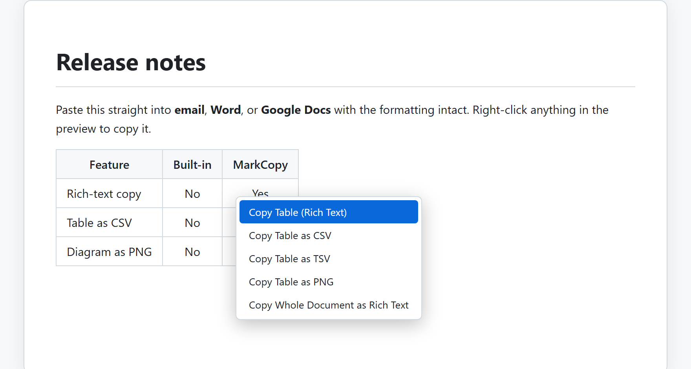
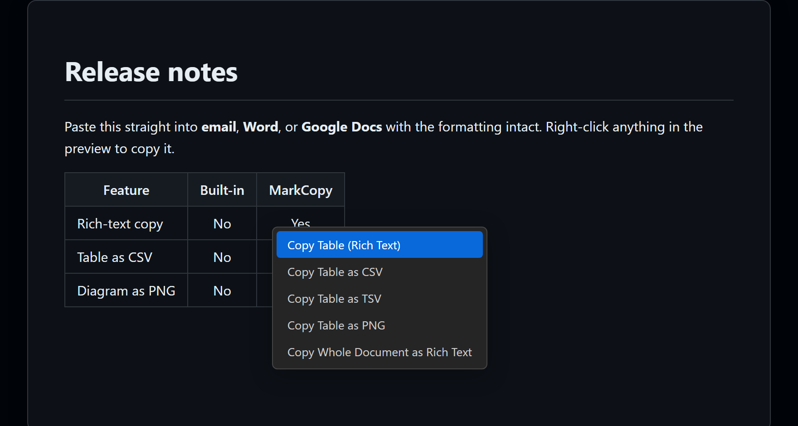

# Copying out

Right-click anywhere in the rendered preview and copy it in the format you need.

<!-- The images are generated from the real preview bundles (media/webview.js, media/pdf.js) + media/preview.css via `npm run screenshot`. A screen-recorded GIF of pasting into Word or Gmail would be a welcome contribution. -->

See the full breakdown in the [Copy Matrix](../COPY-MATRIX.md): every action, the clipboard flavor it writes, and where it pastes cleanly.

## Why it exists

When you copy Markdown you only get `text/plain`, the raw `# heading *asterisks*`. Word, Outlook, Gmail and Google Docs are rich-text editors: they render formatting only when it arrives on the clipboard as `text/html`. MarkCopy renders your Markdown, then writes **both** `text/html` and `text/plain` to the clipboard so the receiving app keeps your headings, bold, lists, tables, links and code. Styles are inlined so the formatting even survives Gmail and Outlook, which strip `<style>` blocks and external CSS.

## Copy as Rich Text

Copy the whole document or just a selection as rich text. It pastes formatted into Word, Outlook, Gmail, Google Docs, Slack and OneNote.

## Per-element right-click copy

Right-click copy is per element, with a short top-level menu that names whatever you clicked and a **Copy as** submenu for every other format:

- Link or email address: top level copies the target itself, as **Copy Link** or **Copy Email Address** (the address without its `mailto:` or any `?subject=`); **Copy as** has **Link Text** and a ready-made **Markdown** link. It leads the menu, ahead of a selection, since right-clicking a link names a single thing.
- Selection: top level copies **Rich Text**; **Copy as** has **Markdown**.
- Code block: top level copies **Plain Text**.
- Table: top level copies **Rich Text**; **Copy as** has **Markdown**, **CSV**, **TSV** (both paste as real cells in Excel and Google Sheets), and **PNG**. This is also how a spreadsheet sheet leaves as a Markdown table.
- Mermaid diagram: top level copies **PNG**; **Copy as** has **SVG**.
- Equation (KaTeX): top level copies **PNG**; **Copy as** has **LaTeX**.
- Any other block: top level copies **Rich Text**; **Copy as** has **Markdown source** and **PNG**.

## Copy as raw Markdown

Raw Markdown can be copied for a selection or a single block, from the **Copy as** submenu.

## How it works

`vscode.env.clipboard` is text-only, so rich copy happens **inside the webview**. MarkCopy writes both `text/html` and `text/plain` through a synchronous `copy`-event handler, which is more reliable than the async Clipboard API (that one can be permission-blocked inside the webview iframe). PNG copy uses `html-to-image` plus a `ClipboardItem`. The full rationale, including the Gmail/Outlook inline-styling requirement, is in [docs/ARCHITECTURE.md](../ARCHITECTURE.md#clipboard).

[Back to the user guide](README.md)
