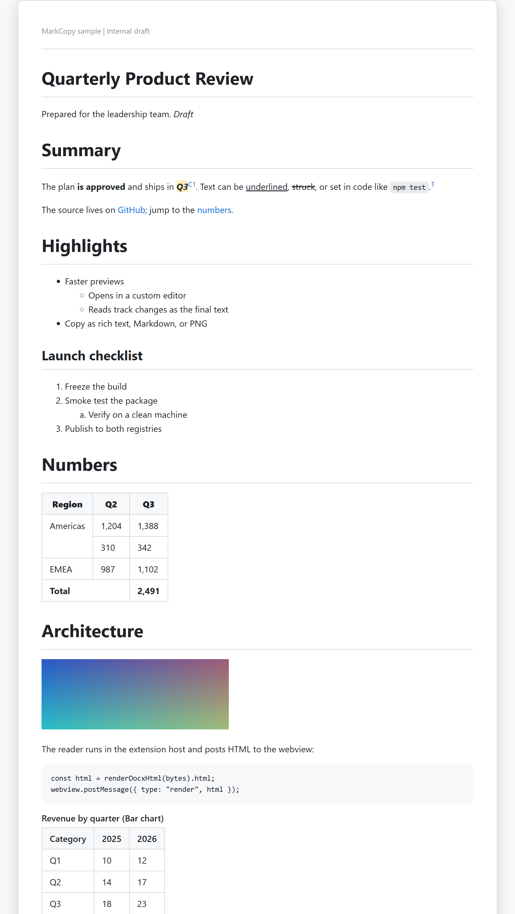
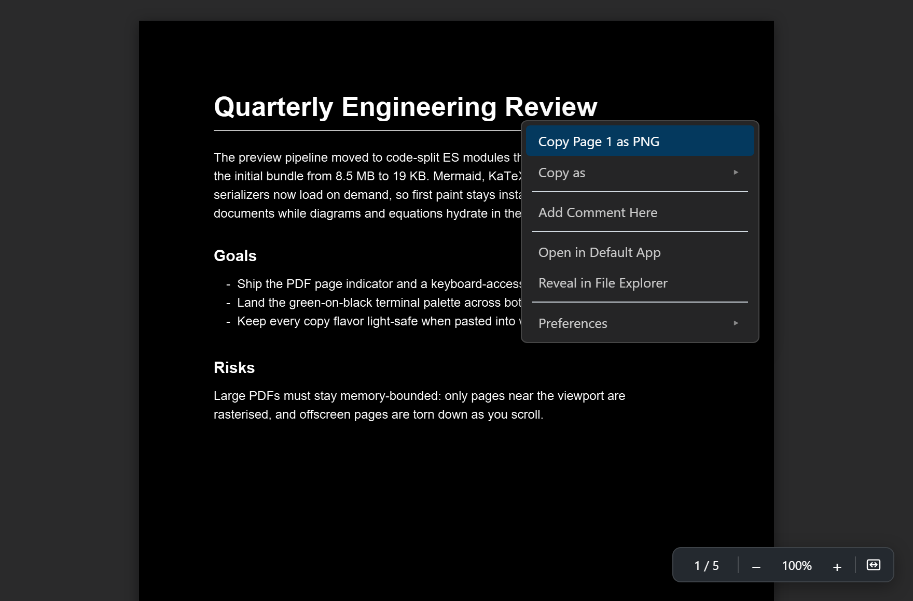

# Documents

Read Word, PowerPoint, PDF, and LaTeX files in the editor as structured, copyable text.

## Word preview

MarkCopy registers as the editor for `.docx` and `.docm` files, so opening one renders it inline instead of leaving it as a binary download, and what you copy out is structured text rather than a picture of a page. Like the PowerPoint preview, it is a column of semantic HTML in the shared preview, which is what lets every copy and export action work on it unchanged. It reads the content, not the layout:

- **Headings.** The Title style becomes a top-level heading and Heading 1 to 6 become `h1` to `h6`, resolved through style inheritance, so a custom style based on Heading 2 is a heading too. A paragraph with an outline level 1 to 6 is a heading even without a heading style. A document that has both a Title and Heading 1 therefore has two top-level headings; the mapping is deliberately a plain function of each paragraph, and it matches what **Save as Word** writes, so a round trip comes back unchanged.
- **Text.** Bold, italic, underline, strikethrough, superscript, subscript, and highlight, whether set on the run, its character style, or its paragraph style. A run or paragraph style set in a monospace font (Consolas, Courier New, and so on) is code, and consecutive monospace paragraphs become one code block. Line breaks and tabs are kept; page breaks are not.
- **Lists.** Bullet or ordered by the list's number format, nested by indent level, with start numbers honored and a list that resumes after other content carrying on counting.
- **Tables.** Merged cells (`gridSpan` and `vMerge`) become `colspan` and `rowspan`, a row Word marks as a header row becomes the header, and tables nest. A row that starts after skipped grid columns keeps its cells in their columns.
- **Links.** Only `http`, `https`, and `mailto` links are followed; any other scheme (`file:`, `javascript:`, a UNC path) is shown as plain text. A link to a bookmark scrolls within the preview, including a table of contents.
- **Images.** Inline and floating pictures show with their alt text and declared size. A format a browser cannot show (EMF, WMF), a picture linked from a URL (never fetched), and one past the image cap (128 MB per document, 32 MB per picture) are drawn as a labelled placeholder. A picture repeated many times is sent once, so repeating it costs nothing; a chart repeated many times still counts against the preview's output budget, and a note at the end says when some are not shown.
- **Tracked changes and fields.** Inserted text is kept and deleted text is dropped, so you see the final text; a field shows its last computed result.
- **Footnotes and endnotes** appear as superscript links with the notes listed at the end.
- **Equations.** Word equations (Office Math, `m:oMath` and `m:oMathPara`) are converted to LaTeX and drawn with KaTeX, exactly like Markdown math. An equation alone in its paragraph or in a display block is display math; one inside a sentence is inline. Fractions, scripts, roots, sums and integrals with limits, brackets, matrices, equation arrays, cases, functions, accents, bars, braces, and Greek and operator symbols are covered. Right-click one to copy it as a PNG or as its **LaTeX source**, and **Copy as Markdown** writes it as `$...$` or `$$...$$`. A construct the converter does not know falls back to its readable contents rather than an error, and an equation over 100,000 characters is left out. The `markcopy.math` setting turns this off, and each equation then shows its LaTeX as code. **Save as Word** from the preview writes equations as images, as it does for Markdown math.
- **Headers and footers.** The first section's header is shown once at the top and the last section's footer once at the bottom, in muted type. Page-number fields are dropped, since a continuous preview has no pages. They are page furniture, so they are left out of every copy and export.
- **Text boxes.** The text inside a text box or shape (including grouped shapes and the older VML kind) is shown as a bordered box right after the paragraph it is anchored to, once, even though Word stores it twice. Pictures inside the box appear in it, also once.
- **Comments.** A commented range is highlighted with a small marker, and the comments are listed at the end with author, date, replies nested under their parent, and a Resolved label. Comments are review notes, so the highlight, markers, and list are left out of every copy and export, while the commented text is kept.
- **Charts.** A chart is shown as a table of the values saved inside it (a title and type caption, one row per category, one column per series), so it copies as CSV or TSV like any table. A chart with no saved values, a newer chart type, or one past the same size budget as images is a labelled placeholder.

Not drawn: SmartArt and embedded objects. A document too large for the preview stops at 50,000 paragraphs and says so. The preview is **read-only by design** and needs nothing installed: no Word, no Pandoc, no browser. A file that is not a real `.docx` (including the older `.doc`) shows a message in the panel rather than failing to open.

Everything copies the way it does in the other previews (**Copy as Rich Text**, **Copy as Markdown**, per-table CSV, **Save as PDF**, **Save as Word**), and the right-click **Search Google** row works on a selection.

## PowerPoint preview

MarkCopy registers as the editor for `.pptx` and `.pptm` files, so opening one renders the whole deck inline instead of leaving it as binary. The whole deck, deliberately, not one slide at a time behind a tab strip the way the [Excel preview](spreadsheets.md#excel-preview) shows one sheet: a deck is meant to be read end to end, and rendering it as one scrollable column of slides is what lets **Copy as Rich Text**, **Save as PDF**, and **Save as Word** take the entire deck in one go rather than whichever slide happened to be on screen.

Slides keep their real layout, positioned the way the file positions them, but the markup underneath is semantic and in reading order rather than z-order, so what you paste out is a readable document and not a jumble:

- **A title placeholder becomes a heading**, body text becomes paragraphs and lists.
- **A slide table becomes a real table.**
- **A picture keeps its alt text.**
- **Speaker notes appear under each slide**, on by default (`markcopy.pptx.showNotes`); they come along whenever you copy the slide.

Every slide is its own right-click block, so **Copy Rich Text**, **Copy as Markdown**, and **Copy as PNG** all work per slide exactly as they do for a block in the Markdown preview, and a table on a slide gets the same full table menu (CSV, TSV, PNG) a Markdown table does.

**Charts, SmartArt, OLE objects, and embedded media are drawn as labelled placeholders** naming what they are, never as blanks. Pretending to render a chart would be worse than admitting there is one. Transitions and animations are not rendered either; a preview is a still document, not a player.

The preview is **read-only by design** (MarkCopy never writes to your presentation) and, like the Excel preview, needs nothing installed to show a deck: no PowerPoint, no Pandoc, no browser. `markcopy.pptx.maxSlides` caps how many slides render before the preview stops and says how many it hid. See [Settings](settings.md#settings) for `markcopy.pptx.*`.

## PDF preview

MarkCopy registers as the editor for `.pdf` files, so opening a PDF renders it inline (VS Code has no built-in PDF viewer). Rendering uses Mozilla's pdf.js, the same engine behind [folio](https://github.com/owenpkent/folio). Each page has a real, selectable text layer over the canvas, so you can highlight text directly on the page. Right-click a page for:

- **Copy Selection**: just the text you highlight (only shown when you have a selection).
- **Copy Page as PNG**: the rendered page as an image, for slides and chat.
- **Copy as**: **Page Text** or **All Text**, the selectable text extracted per page or for the whole document.
- **Add Comment Here**: drop a pin with an editable note; click a pin to edit or delete it. Comments are saved to a `<filename>.pdf.mccomments.json` file next to the PDF (the PDF itself stays read-only) and reload when you reopen it.
- **Preferences**: toggle between **Hand Tool (Drag to Scroll)** and **Pointer Tool (Select Text)**, toggle **Dark Pages** / **Light Pages** (a session-only override of the page palette that does not change the saved theme), and open the same **Theme** submenu as the Markdown preview (Auto, Light, Dark, or Green on black). Picking a theme persists `markcopy.theme` (shared with the Markdown preview) and re-tints the pages; Green on black renders them as green-on-black phosphor.

A floating toolbar in the bottom-right corner shows the current page (for example `3 / 12`) as you scroll; click it, type a page number, and press Enter to jump there. The same toolbar steps zoom through preset levels (50 to 400 percent) with minus/plus buttons, Ctrl and plus / Ctrl and minus / Ctrl and 0, or Ctrl plus the mouse wheel; clicking the percentage resets to 100 percent. The fit-width button (a page with a double-headed arrow across it, the same icon [folio](https://github.com/owenpkent/folio) uses) fits the page to the width of the pane and stays on, re-fitting as you resize the editor, until you zoom by hand again. Zooming keeps your place: whatever sits in the middle of the view stays there instead of the page sliding out from under you. Pages re-rasterise at each level, and only pages near the viewport stay rendered, so large PDFs stay sharp and memory-bounded. The view also has always-visible styled scrollbars.

The file is read by the extension host and handed to the webview as bytes, so nothing is fetched over the network. To open a PDF as raw bytes instead, use **Reopen Editor With...** from the editor title menu.

## LaTeX preview

MarkCopy registers an editor for `.tex`, `.ltx`, and `.latex` files, but as an option (`option` priority) rather than the default: unlike a PDF, an STL, or a video, a `.tex` file is one you spend most of the day editing, so opening one still opens the text editor. The preview, though, opens on its own: with `markcopy.autoPreview` on (the default), opening or focusing a `.tex` file also opens (or reveals) the preview in a tab beside it, the same as Markdown, CSV, and TSV, without moving your cursor away from the source. Close that preview and it stays closed for that file until you reopen it. You can also reach it by hand: right-click the file (in the editor tab bar or the Explorer) and choose **Reopen Editor With...** > **MarkCopy LaTeX Preview**, or run **MarkCopy: Open Rich Preview to the Side**.

The preview compiles your document to a PDF and shows it through the exact same viewer as [PDF preview](#pdf-preview) above, so it gets that viewer's whole feature set for free: a selectable text layer, right-click **Copy Page as PNG** and **Copy Selection**, pinned comments, zoom, and the shared **Theme** submenu.

**An external LaTeX engine is required and is not bundled.** MarkCopy compiles with whatever is already on your machine; it does not ship a LaTeX distribution, which would be gigabytes on its own. You need one of:

- **Windows:** MiKTeX or TeX Live.
- **macOS:** MacTeX, or `brew install --cask mactex-no-gui`.
- **Linux:** your distribution's TeX Live package.
- **Any platform:** [Tectonic](https://tectonic-typesetting.github.io/), a single small binary that fetches packages as your document needs them, the easiest way in if you would rather not pull down a multi-gigabyte distribution just to preview one file.

With none of those found, the preview says so and names these same options rather than showing a blank panel. MarkCopy looks for `latexmk` first, then `tectonic`, then the bare engines (`pdflatex`, `xelatex`, `lualatex`), since `latexmk` and `tectonic` rerun the document themselves until cross-references and the bibliography settle; set `markcopy.tex.engine` to pick one specifically, or `markcopy.tex.enginePath` to point at an executable that is not on your `PATH`. `-shell-escape` is never passed to any engine, deliberately: it would let a document's own source run arbitrary shell commands, and the entire point of a preview is that opening someone's repository is safe.

The preview recompiles whenever you save the document, or a `.bib`, `.sty`, `.cls`, or `.tikz` file beside it, since a thesis is usually a root file that pulls in chapters and a bibliography. To recompile without saving, use the floating **Recompile** button, the refresh icon in the editor title bar, **MarkCopy: Recompile LaTeX** from the Command Palette, or **Recompile LaTeX** in the right-click menu. For a project where the file you are editing is a chapter rather than the document to compile, either add a `% !TEX root = ../main.tex` comment near the top of the chapter, or set `markcopy.tex.rootFile`; either way MarkCopy compiles the root file and still shows its PDF while you edit the chapter.

Your source and its build files are never touched by any of this: MarkCopy compiles into a temporary folder of its own and deletes it when you close the preview.

[Back to the user guide](README.md)
