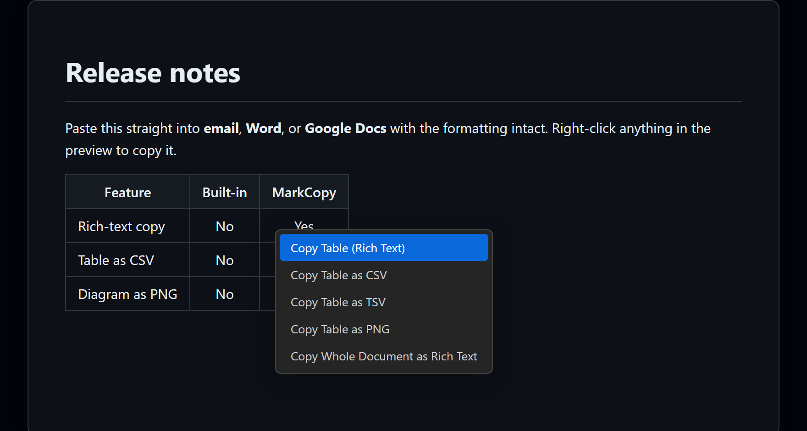
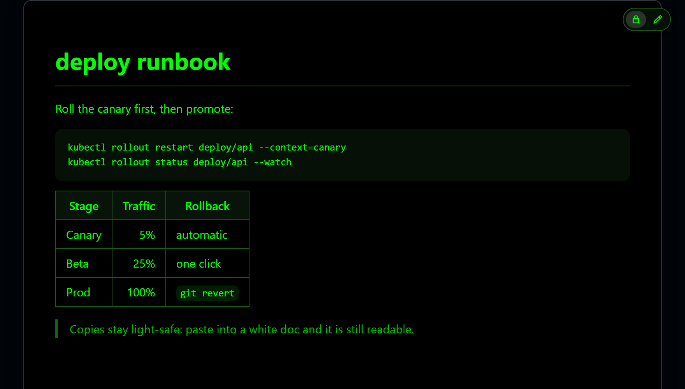
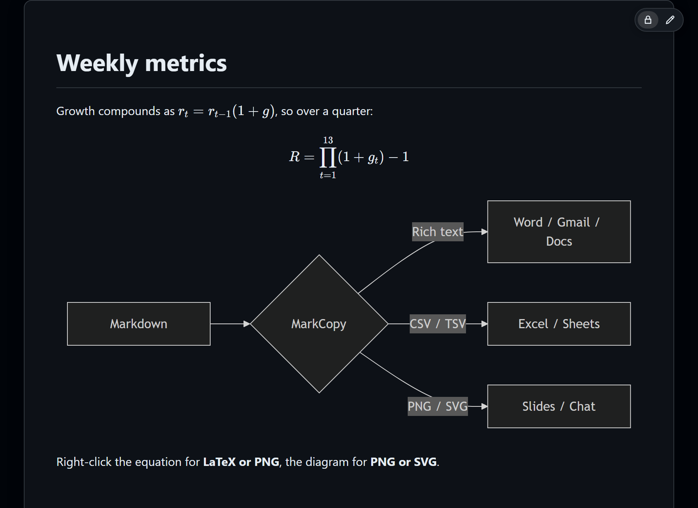
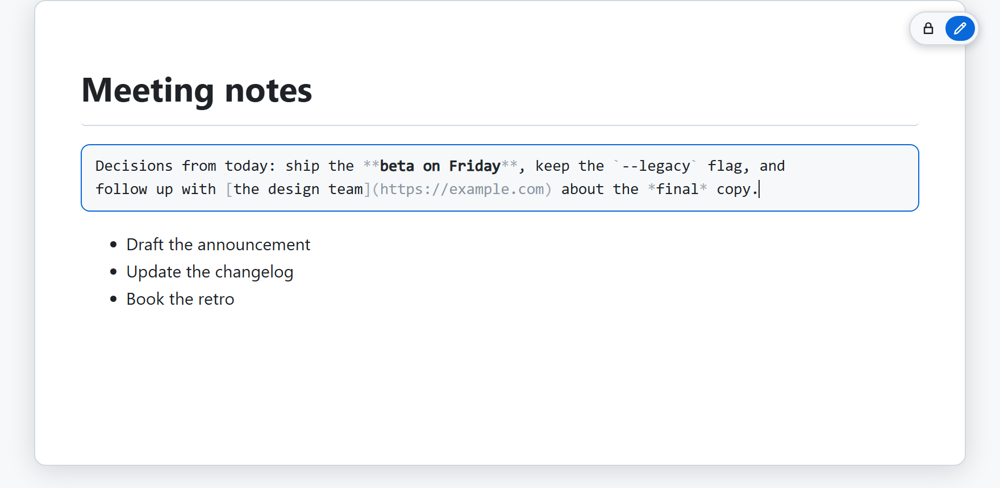
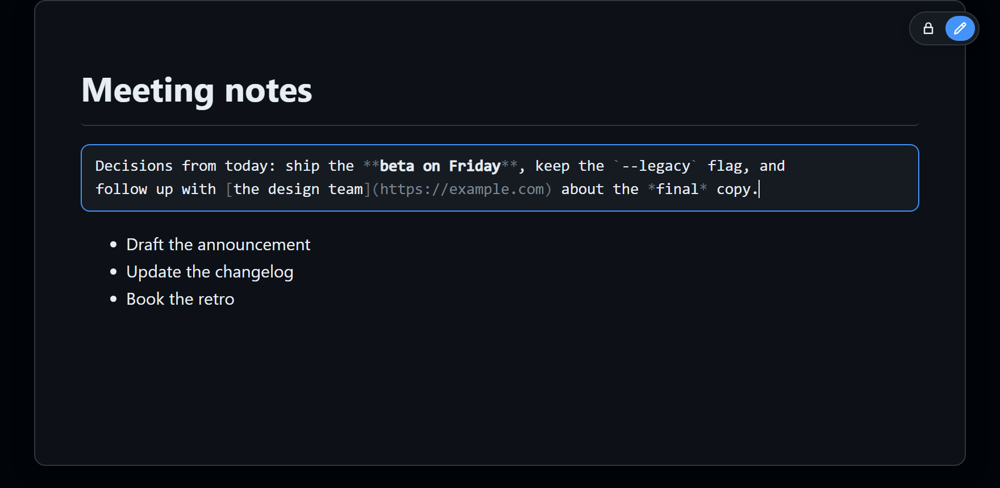

# Markdown preview

A live, GitHub-accurate rendering of your Markdown, with light editing built in.

## Live preview and scroll sync

The preview updates as you type, with editor and preview scroll kept in sync.

## Auto-open

The preview opens automatically in the file's own tab by default (`markcopy.autoPreview`). See [Auto-preview](getting-started.md#auto-preview) for the details.

## GitHub-accurate styling

Styling is GitHub-accurate, for output that pastes cleanly into docs and email.

## Footnotes

`[^note]` references render as numbered links to their definitions, with return links back to the prose. A definition with no reference stays in place as plain text rather than disappearing. Toggle with `markcopy.footnotes` (on by default, turn it off for documents that use literal `[^...]` text).

A long line in a fenced code block wraps to the preview's width rather than scrolling the block sideways, so the whole line is in view. Only the display changes: the line breaks in the source, and what **Copy Block** puts on the clipboard, stay as they are. Turn it off with `markcopy.wrapCode` or **Preferences → Wrap code lines** in the right-click menu.

## Light and dark themes

The preview follows your VS Code theme, with a polished GitHub-light or GitHub-dark palette, and copied rich text is always light-safe, so it stays readable when pasted into a white document even from a dark preview.

An optional **green-on-black** terminal palette is available too (`markcopy.theme: green`, or **Green on black** under **Preferences > Theme**):

## Mermaid diagrams

Mermaid diagrams (flowchart, sequence, class, state, gantt, pie, and more) follow the light/dark theme, and syntax-highlighted code works out of the box. Configure Mermaid via `markcopy.mermaid`; diagrams keep the classic layout and look unless you set `"layout": "elk"` or `"look": "neo"`.

## Math rendering with KaTeX

Inline `$...$` and display `$$...$$` Markdown math render as equations. Right-click one to copy it as a PNG or restore its original LaTeX source; "Copy as Markdown" also restores the LaTeX rather than the rendered markup. Toggle with `markcopy.math` (on by default, turn it off for docs that use literal dollar signs).

## Local images

Local images render in the preview. Relative and absolute paths (``, ``) resolve to the right file. HTML images such as `` work too. An image that gives both a width and a height keeps its shape when a narrow pane shrinks it.

Remote images are blocked by default. When a preview reports blocked images, its settings link opens MarkCopy settings. Enable `markcopy.allowRemoteImages` in your user settings to allow HTTPS images in previews and PDF exports. Plain HTTP images are always blocked.

A display equation too long for the pane wraps onto further lines after an `=`, `+`, or similar operator, keeping its display size. One with nowhere to break (a single wide fraction, say), or one using `	ag` or an `align`-style environment, which only KaTeX's display mode supports, scrolls sideways inside its own box instead.

## Edit mode

Flip the lock/pencil pill in the top-right corner of a Markdown preview to edit the raw Markdown of a block in place: click a paragraph, heading, list, table, or quote, edit it in a box with light syntax dimming, and press Ctrl/Cmd+Enter or click away to write it back to the file (Escape cancels). It also works from the keyboard: Tab to a block, then Enter or F2 to edit it. It is an ordinary undoable editor change and the file is not saved for you.

## Auto-scroll

Auto-scroll glides the page for you, hands-free. Press the auto-scroll button in the pill at the top right (after the lock and pencil; it stays lit while on), or right-click the page and choose **Start Auto-scroll**. A puck appears in the bottom-right corner with a large round **Play**/**Pause** button and **-** and **+**, and works exactly as in the [PDF preview](documents.md): **+** is faster downward, **-** faster upward and, past the slowest speed, turns around; hold either to keep stepping; right-click the puck for Small, Medium, Large or Extra large. **Space** pauses and resumes, the arrow keys and **+** / **-** change the speed, and **Escape** stops. Scrolling by hand is carried on from, and it stops by itself at the end or the top, announcing it to screen readers. Editing the file while it runs does not stop it: the page is held still while the preview redraws and a moment after, then it carries on from wherever the page is, and it waits while a block editor is open. While it plays, scrolling that document's source does not move the preview (the preview leads); scroll sync for other documents is unaffected. Space leaves a focused button, link or disclosure summary to do its own job. Auto-scroll waits (for up to about 2 seconds) while an image near the end is still loading rather than reporting the end too early, and Escape on the puck returns focus to the toolbar button. The speed and size are remembered per preview while it stays open (hide and show the tab), not shared with the PDF preview or kept after the tab is closed.

## Search Google for a selection

Select some text and right-click for **Search Google for "…"**, which opens the search in your browser.

[Back to the user guide](README.md)
