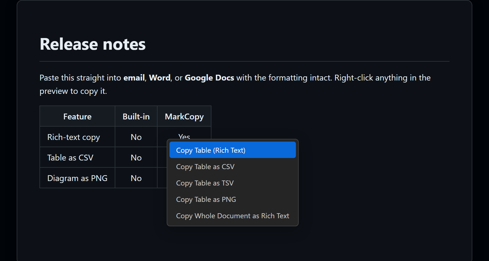
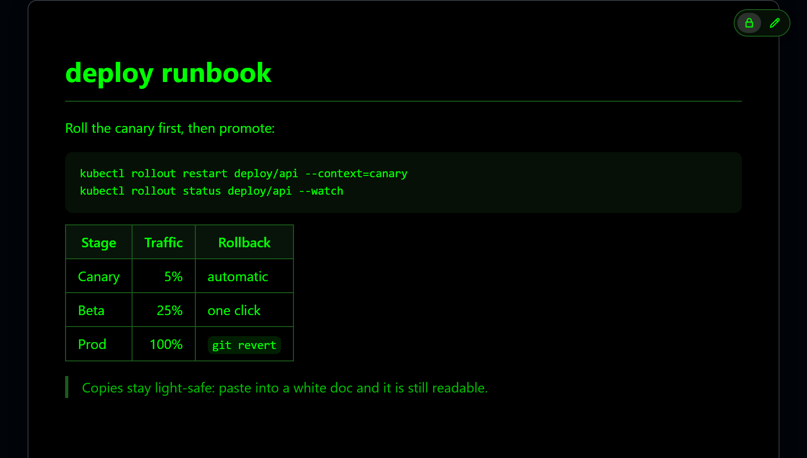
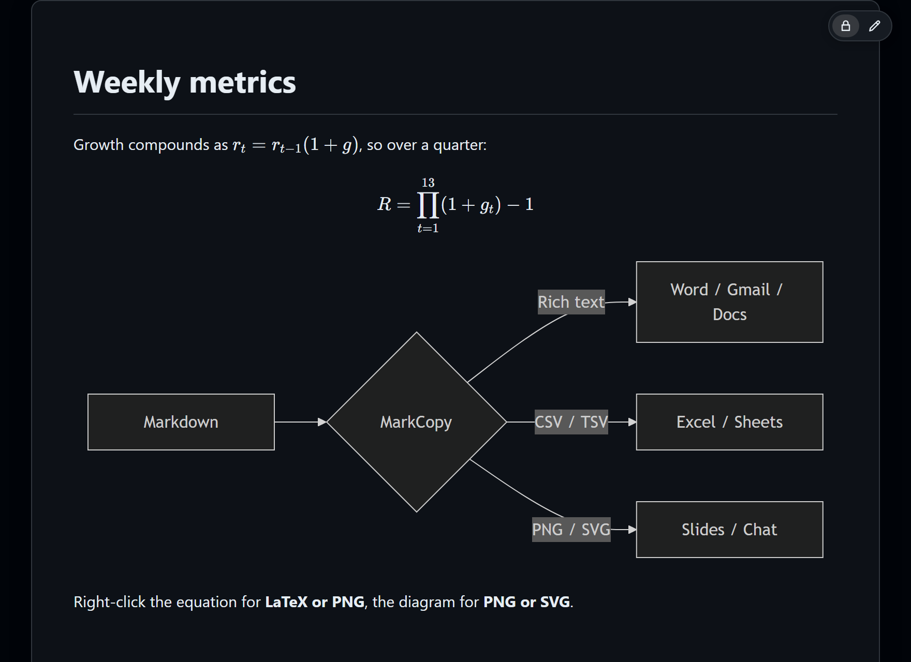
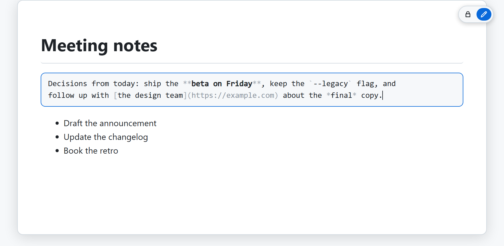
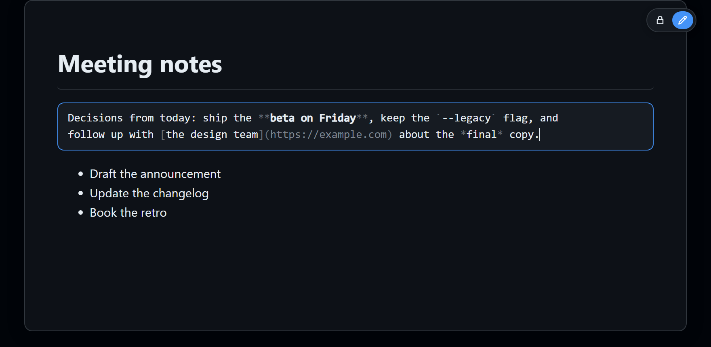

# Markdown preview

A live, GitHub-accurate rendering of your Markdown, with light editing built in.

## Live preview and scroll sync

The preview updates as you type, with editor and preview scroll kept in sync.

## Auto-open

The preview opens automatically in the file's own tab by default (`markcopy.autoPreview`). See [Auto-preview](getting-started.md#auto-preview) for the details.

## GitHub-accurate styling

Styling is GitHub-accurate, for output that pastes cleanly into docs and email.

## Footnotes

`[^note]` references render as numbered links to their definitions, with return links back to the prose. A definition with no reference stays in place as plain text rather than disappearing. Toggle with `markcopy.footnotes` (on by default, turn it off for documents that use literal `[^...]` text).

A long line in a fenced code block wraps to the preview's width rather than scrolling the block sideways, so the whole line is in view. Only the display changes: the line breaks in the source, and what **Copy Block** puts on the clipboard, stay as they are. Turn it off with `markcopy.wrapCode` or **Preferences → Wrap code lines** in the right-click menu.

## Light and dark themes

The preview follows your VS Code theme, with a polished GitHub-light or GitHub-dark palette, and copied rich text is always light-safe, so it stays readable when pasted into a white document even from a dark preview.

An optional **green-on-black** terminal palette is available too (`markcopy.theme: green`, or **Green on black** under **Preferences > Theme**):

## Mermaid diagrams

Mermaid diagrams (flowchart, sequence, class, state, gantt, pie, and more) follow the light/dark theme, and syntax-highlighted code works out of the box. Configure Mermaid via `markcopy.mermaid`; diagrams keep the classic layout and look unless you set `"layout": "elk"` or `"look": "neo"`.

## Math rendering with KaTeX

Inline `$...$` and display `$$...$$` Markdown math render as equations. Right-click one to copy it as a PNG or restore its original LaTeX source; "Copy as Markdown" also restores the LaTeX rather than the rendered markup. Toggle with `markcopy.math` (on by default, turn it off for docs that use literal dollar signs).

## Local images

Local images render in the preview. Relative and absolute paths (``, ``) resolve to the right file; remote (`http(s):`), `data:`, and `blob:` images are unchanged.

## Edit mode

Flip the lock/pencil pill in the top-right corner of a Markdown preview to edit the raw Markdown of a block in place: click a paragraph, heading, list, table, or quote, edit it in a box with light syntax dimming, and press Ctrl/Cmd+Enter or click away to write it back to the file (Escape cancels). It also works from the keyboard: Tab to a block, then Enter or F2 to edit it. It is an ordinary undoable editor change and the file is not saved for you.

## Search Google for a selection

Select some text and right-click for **Search Google for "…"**, which opens the search in your browser.

[Back to the user guide](README.md)
