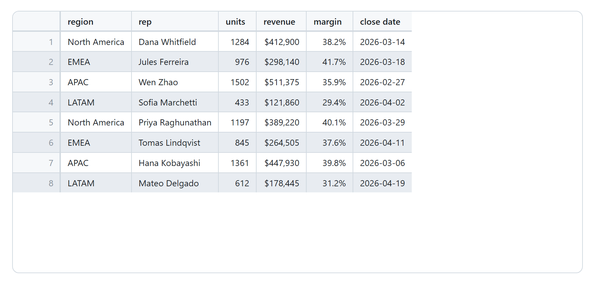
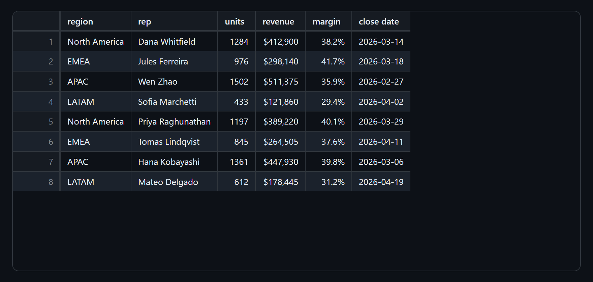

# Spreadsheets

Preview CSV, TSV, and Excel files as a spreadsheet-style grid.

## CSV and TSV preview

Open a `.csv`, `.tsv`, or `.tab` and it renders as a spreadsheet-style grid instead of a wall of commas: a sticky header row and row-number gutter, alternating row colors, numeric columns aligned right, and long values clipped with an ellipsis so rows stay one line tall. The delimiter is detected automatically (comma, tab, semicolon, or pipe, with a `.tsv` or `.tab` always read as tab-separated) and quoted fields follow RFC 4180, so commas, quotes, and newlines inside a cell all survive. See [Settings](settings.md#settings) for `markcopy.csv.*`.

- **Edit cells in place.** Click to select, then double-click, press Enter or F2, or just start typing. **Enter** commits and moves down, **Tab** commits and moves right, **Shift+Enter** puts a newline inside the cell, **Escape** discards, **Delete** clears, and the arrow keys move around. Headers are editable too. Edits go straight into the file as ordinary document changes, and only the edited field is rewritten: the rest of the row keeps its original bytes, quoting and line endings included.
- **Insert and delete rows and columns.** Right-click a cell, a column header, or a row number: **Insert** offers Row Above, Row Below, Column Left, and Column Right, and **Delete** offers Row and Column. A new row is blank and as wide as the row it lands next to, so a ragged file stays as ragged as it was; a new column opens down the whole file, not just the rows on screen. The grid then moves under the cursor the way a spreadsheet does, so after Insert Row Above you are standing on the new blank row. Like a cell edit, each one is written into the file as a single change, so one **Ctrl+Z** takes back a column that touched ten thousand rows, and every field that did not move keeps its original bytes.

- **Undoing an edit.** Every change the grid makes is an ordinary edit to the document, so it lands in that file's normal undo stack: **Ctrl+Z** in the file's own text editor takes back the last cell, row, or column, one press per change, and the grid re-renders to follow. It has to be the text editor that has focus, though. Pressing Ctrl+Z with the preview focused does nothing, because VS Code sends undo to a focused editor and a preview panel is not one. For the same reason, keep the file open in an editor while you work in the grid: with no text editor for it anywhere, an edit has nothing to land in and is dropped.
- **Resizable columns.** Drag any column divider, double-click one (or press Enter on it) to fit the column to its contents, and right-click for **Reset Column Widths**.
- **Copy anything out.** The grid is a real table, so the whole right-click copy menu works on it: **Copy Table** as rich text, or **Copy as** CSV, TSV, or PNG. The row-number gutter is viewer chrome and stays out of every one of them, so what you paste is the data in the file. A single cell comes out too, under **Copy as** > **Cell Text**, and when a cell holds an email address or a URL, the menu leads with **Copy Email Address** / **Copy Link** and takes just that value out of whatever text surrounds it, which nothing else in a `.csv` can do without a careful drag.

## Excel preview

Open an `.xlsx` or `.xlsm` and it renders as a grid, with sheet tabs along the top and the column letters and row numbers a spreadsheet shows. Values appear the way the workbook formats them, so a date is a date and not `45000`, a percentage is `15.3%` and not `0.153`, and a formula shows its stored result. Merged cells stay merged, and anything the author hid (rows, columns, or whole sheets) stays hidden. Then right-click and take the whole sheet out as rich text, Markdown, CSV, TSV, or PNG.

The preview is **read-only by design**: MarkCopy never writes to your workbook, so it cannot corrupt one. See [Settings](settings.md#settings) for `markcopy.xlsx.*`.

[Back to the user guide](README.md)
