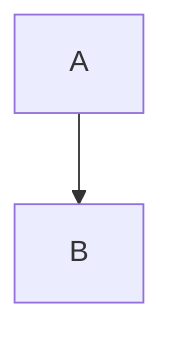

# Title

| a | b |
|---|---|
| 1 | 2 |



Inline $x^2$ and

$$
rac{a}{b}
$$

Note[^1] <b onclick="x">raw</b> https://example.com [link](javascript:alert(1)) 

[^1]: footnote text

- [ ] task
- [x] done

```js
const a = 1;
```
