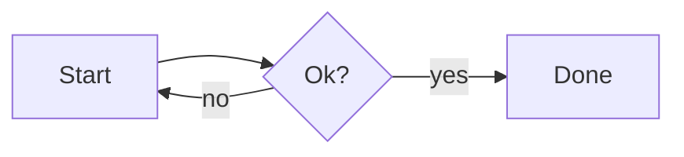

# Release notes 1.4

Intro with **bold**, *italic*, ~~strike~~, `code` and a [link](https://example.com/a?b=1&c=2 "title").

## Changes

| Area     | Before | After | Notes          |
| :------- | -----: | :---: | -------------- |
| Parser   |    120 |  95   | faster         |
| Renderer |     80 |  80   | `unchanged`    |
| Escapes  |      1 |  2    | pipe \| inside |

1. First
   - nested bullet
     - deeper bullet
   - second bullet
2. Second
   1. sub one
   2. sub two

- [x] write tests
- [ ] ship
  - [ ] nested task

> A quote
>
> > nested quote with a footnote[^note]

Inline math $E = mc^2$ and display math:

$$
\int_0^\infty e^{-x^2}\,dx = \frac{\sqrt{\pi}}{2}
$$



```ts
export const add = (a: number, b: number): number => a + b;
```

<details>
<summary>More</summary>

Hidden <kbd>Ctrl</kbd>+<kbd>C</kbd> text.

</details>

<div align="center"></div>

Term
: not standard definition syntax

Line one  
line two with hard break\
and a backslash break.

***


[^note]: The footnote text, with a [link](#release-notes-14).
